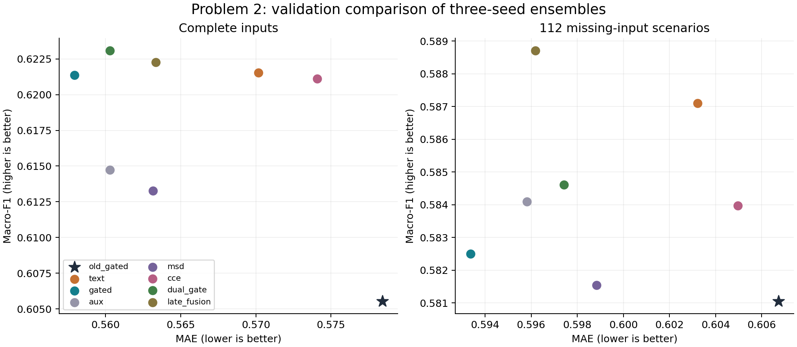

这次审阅的结论是：问题二已经形成了完整、可复现的求解链条。现在最值得做的是把主方法、对照实验和未成功的探索分清楚，统一结果口径，再补少量有针对性的证据。现有结果不支持继续把复杂模块一层层加上去，也不支持把新版描述成全面胜过旧版。

当前正式模型仍是 `step2` 的 `gated_aug` 三种子集成，在 `step2_v2` 和 `step2_refine` 中叫 `old_gated`。`step2_v2/deployment` 是它的部署材料；v2 的 `gated` 是改进候选，并没有成为最终模型。后续 `step2_refine` 的两个候选也没有替换它。

本次新增的文件都在 `problem2_review` 内，原实验代码、权重、预测和选择记录保持原样。以下数值来自本地实验，并已按后文说明复核；涉及“为什么可能有效”的说明是建模动机，不能与已证实的效果混为一谈。

**先把问题二真正要回答的事情说清楚。** 原题要求处理的是一个或多个模态的局部连续时间段不可用，输出负向／中性／正向三分类以及连续情感强度，并分析缺失类型、位置、长度的影响，最后预测附件3。问题二还需要验证集基础性能、可视化及错误分析。中性严格对应真实强度0，不能改成常见的正负二分类。

原题允许问题二直接采用附件2，所以不必先把问题一提取出的100条特征接入问题二。当前实际使用附件2的 `aligned_50`：3395条训练、728条验证、727条测试。三组源视频互不交叉。附件3有30条无标签样本，只能提交预测，不能报告“专项准确率”。

题目本身没有要求使用EBMC、蒸馏、双门控，也没有规定“缺失F1必须增加0.01”等替换门槛；这些是项目自己的方法选择和实验协议。

**当前主方法可以用一条链条解释。**

从输入到输出，各项设计解决的问题如下。

| 环节 | 实际做法 | 为什么这样做；边界在哪里 |
|---|---|---|
| 统一输入 | 文本由固定DistilBERT编码为50×768，音频50×74，视觉50×35 | 附件3没有与附件2相同的预计算`text`，采用统一`text_bert`接口才能保持训练和推理一致。没有重新从原视频提取这两种数值模态 |
| 冻结文本编码器 | 只训练后面的轻量情感网络 | 复用通用语义表示、控制训练规模；不代表已经证明冻结优于微调 |
| 区分三种掩码 | 有效位置P、原有观测O、人工删除D，最终可用位置为O且非D | padding不是故障，全零行也不能全部称为已知人工缺失。UNK被统一当作词义不可恢复 |
| 文本缺失处理 | 删除词元、屏蔽attention之后，重新计算上下文 | 若先编码整句再清零部分向量，被删除词的信息可能已经进入剩余词向量；现有实现避免了这种泄漏 |
| 标准化 | 只在训练集有效可用位置拟合均值和标准差 | 防止验证／测试参与拟合，缓解不同模态数值尺度差异 |
| 时序分支 | 投影到64维，两个残差卷积层，核3、膨胀率1和2 | 保留局部顺序和邻域上下文；不是仅取全句均值，也不是大型跨模态Transformer |
| 掩码池化 | 在可用位置做注意力加权和均值池化，再合并 | 不把没有观测的槽位当作真实内容平均进去 |
| 缺失感知门控 | 输入内容表示、可用比例、最长不可用段比例、有效长度比例 | 相同缺失率可能对应不同连续缺失结构；模型可以据此调整三模态的融合权重 |
| 双任务输出 | 分类概率以及3×tanh的连续强度 | 极性与强度是两个要求，强度限制在[-3,3]；两个头没有硬性符号一致约束 |
| 缺失增强 | 训练时主动删除连续区间 | 让学习过程见过不完整输入，减少只在完整输入训练产生的脆弱性 |
| 三种子集成 | 平均分类概率和强度预测 | 减少单次随机训练带来的波动；性能表必须区分单模型均值和集成成绩 |

旧版主模型的融合可以写为

\[
q_m=[\text{可用比例},\text{最长不可用段比例},\text{有效长度比例}],\qquad
\beta_m=\operatorname{softmax}_m g([h_m,q_m]),\qquad z=\sum_m\beta_m h_m.
\]

分类和回归共享融合后的MLP，旧版损失为类别加权交叉熵加SmoothL1；类别权重由训练集类别频数的逆平方根得到。v2候选把回归项权重选为2。**最终选中的旧权重仍是按旧版权重1训练的，不能将v2候选的训练超参数写到最终模型上。**

这里的门控是“每条样本、每个模态”的片段级权重。它前面有局部时序编码，但不是对每一个时间位置都学习一组三模态融合权重。模型主要学习利用剩余观测，没有重建真实丢失语音、视频或词义。门控数值也不是问题三的模态贡献证明。

**三个目录对应三轮不同的研究问题。**

| 目录／路线 | 要检验的问题 | 实际变化 | 已有结论 |
|---|---|---|---|
| `step2` 基线与主方法 | 连续缺失时，增强、显式掩码和动态融合能否改善？ | 单模态、统计池化、固定融合，以及逐步加入增强、掩码、门控 | 门控＋掩码＋增强按验证综合目标获选，完成测试和附件3预测 |
| `step2_v2` 基础改进 | 更丰富的遮挡及训练设置能否改善？ | 固定6个增强视图改为逐轮动态遮挡；完整输入概率25%改50%；回归权重1改2；训练阶段、调度及部分掩码实现变化 | 新`gated`的整体回归更好，但缺失分类提升很小，强正向误差变大 |
| `step2_v2` 复杂模块 | 能否增强音视频、改善模态协作？ | 辅助监督→共享／特有分解→局部互补增强→可信蒸馏→能量协调 | 未形成足以替换旧模型的收益；最佳新候选反而是未加这些模块的`gated` |
| `step2_refine` 双门控 | 分类与回归是否需要不同模态权重？ | 分类、回归各用一套门控，分支和后续MLP仍共享 | 局部指标改善，无稳定整体优势，强正向回归仍不理想 |
| `step2_refine` 后融合 | 先让各模态独立预测，再融合，能否减少共同训练的干扰？ | 冻结文本／音频／视觉专家，按质量特征学习两个任务的混合权重 | 缺失平均F1较高，但强情感幅度误差增大，未通过替换门槛 |

v2复杂路线借鉴的是“先增强弱模态，再协调模态协作”的[EBMC研究](https://arxiv.org/html/2604.12518v2)。本地实现使用了自己的64维网络、连续区间缺失和分类／回归双任务，是方法适配，不能等同于复现原论文全部模型或指标。

| 新增部件 | 建模动机 | 本地结果应如何解释 |
|---|---|---|
| AUX：单模态辅助监督 | 让每个分支独立承担情感预测任务，减少完全依赖文本的可能 | 相对新`gated`，缺失F1略升，但完整F1和两类平均MAE没有同步改善 |
| MSD：共享／特有分解 | 分离跨模态一致内容与各模态独有信息 | 未得到整体更优成绩；现有结果不能证明分解到了可解释的真实语义因素 |
| CCE：局部互补增强 | 用同位置其他可用模态帮助当前模态 | 只增强仍有观测的位置，没有恢复缺失真值；中性召回较高但平均回归不如新`gated` |
| IMTD：可信分类蒸馏 | 用覆盖率和预测熵加权教师意见 | 第二阶段确实运行，但3个最终检查点都来自第一阶段 |
| EMC：能量协调 | 约束不同模态的表示与学习状态 | 第二阶段确实运行，但3个最终检查点也都来自第一阶段 |

我核对了训练日志中的非零KD／EMC损失，并比较了完整预测数组：`cce`、`imtd`、`emc`最终保存的验证预测完全相同。因此应写“当前训练预算和选择规则下，第二阶段未带来被保留的收益”，不能写成三套不同模型都取得同样优良成绩，也不能把它解读成这些方法在所有任务上都无效。

旧版到v2同时改变了遮挡库、完整样本比例、回归权重、训练调度等；代码还存在旧版投影后乘P、新版乘O，以及固定融合对缺席模态的归一化差别。**跨版本结果不是动态增强的单因素消融，不能把全部改善归因于动态增强。**

**效果首先要看旧版主方法是否解决了局部缺失问题。** 以下是同一727条测试样本、同样三种子集成的对照。缺失条件统一为TAV同步随机单连续段、50%有效槽位，平均3次遮挡。

| 旧版结构 | 完整F1↑ | 完整MAE↓ | 缺失F1↑ | 缺失MAE↓ |
|---|---:|---:|---:|---:|
| 固定融合、仅完整训练 | 0.6007 | 0.6609 | 0.4328 | 0.7936 |
| 固定融合＋缺失增强 | 0.5847 | 0.6537 | 0.5180 | 0.7384 |
| 再加显式掩码与缺失统计 | 0.5912 | 0.6585 | 0.5280 | 0.7413 |
| 再加门控，即最终旧模型 | 0.5989 | 0.6512 | 0.5316 | 0.7304 |

从这张表能得到三个层次的结论。首先，整个鲁棒方案比只用完整输入训练的固定融合明显更抗缺失：F1增加0.0988，即9.88个百分点，MAE减少0.0632。其次，最大的F1提升来自增强这一步，约8.52个百分点；再加掩码与缺失统计约0.995个百分点，再加门控约0.357个百分点。最后，收益并非每一步都覆盖所有指标：掩码步骤的缺失MAE略变差，增强也牺牲了一部分完整输入F1。

原有视频分组bootstrap支持“最终方案相对完整训练固定融合”在一个固定TAV50%遮挡实现上的优势，但没有直接证明“门控相对掩码固定融合”的微小增益稳定显著。因此主张应是“连续缺失训练与缺失感知融合构成有效方案”，不宜把全部鲁棒性归功于门控。

**不同版本要放到同一验证口径比较。** 下表均为728条验证样本、三种子集成；“缺失平均”均先在同场景内平均重复，再等权平均112种单连续区间场景。它与旧版只平均随机位置的`robustness_average.csv`不是同一统计量，也不是某一TAV50%压力点。

| 模型 | 完整F1↑ | 完整MAE↓ | 缺失平均F1↑ | 缺失平均MAE↓ | 中性召回↑ |
|---|---:|---:|---:|---:|---:|
| 旧门控：正式采用 | 0.6055 | 0.5784 | 0.5811 | 0.6067 | 0.4076 |
| v2文本单模态 | 0.6215 | 0.5702 | 0.5871 | 0.6032 | 0.5000 |
| v2固定融合 | 0.6054 | 0.5813 | 0.5776 | 0.6102 | 0.4891 |
| v2门控：最佳新候选 | 0.6214 | 0.5579 | 0.5825 | 0.5934 | 0.4783 |
| v2＋AUX | 0.6147 | 0.5603 | 0.5841 | 0.5958 | 0.4674 |
| v2＋AUX＋MSD | 0.6133 | 0.5631 | 0.5815 | 0.5988 | 0.5109 |
| v2＋AUX＋MSD＋CCE | 0.6211 | 0.5741 | 0.5840 | 0.6050 | 0.5109 |
| refine双门控 | 0.6231 | 0.5603 | 0.5846 | 0.5974 | 0.4674 |
| refine后融合 | 0.6223 | 0.5633 | 0.5887 | 0.5962 | 0.4891 |

完整输入的v2音频、视觉单模态F1分别只有0.3189、0.4076，明显落后于文本0.6215。文本也是非常有竞争力的缺失基线：新门控在缺失平均MAE上较优，却没有超过文本的缺失平均F1。文本模型在只删除A／V的场景当然不受影响，整体平均会包含这些场景；所以还需要分别呈现T、TA、TV、TAV含文本缺失的对比，才能具体说明音视频在什么条件下有用。

新门控相对旧门控，完整F1提高1.58个百分点，缺失平均F1仅提高0.144个百分点；对应MAE分别降低0.0205、0.0134。已有视频分组配对区间中，两项F1差值的95%区间都跨0；两项MAE差值的区间不跨0。这支持“在当前验证集上的回归改善证据更强”，不支持“分类鲁棒性显著增强”。这些区间又以反复使用的验证集及已选模型为条件，不能当作独立外部验证。

目前保留旧模型，是因为新门控没同时满足“缺失F1至少增加0.01”以及“强正向MAE最多增加0.02”。它的强正向MAE由1.0198增至1.0699，增加0.0501。双门控和后融合也有类似未通过项。这个决策符合事先写入项目的替换规则，但不能表述成“旧模型在所有指标上最好”；如果只按六场景综合J，新门控0.9697优于旧门控0.9926。

不应为让某个模型获选，在看完结果后临时降低原门槛。若未来研究目标改变，应在新一轮实验前定义取舍，并将其与现有锁定结论分开。

**测试和专项推理能说明的范围也要固定。**

| 模型 | 完整测试Accuracy↑ | 完整测试F1↑ | 完整测试MAE↓ | Pearson↑ |
|---|---:|---:|---:|---:|
| 正式旧门控 | 0.6492 | 0.5989 | 0.6512 | 0.6546 |
| v2文本 | 0.6534 | 0.6166 | 0.6501 | 0.6560 |
| v2门控 | 0.6561 | 0.6058 | 0.6416 | 0.6616 |

我另外统一汇总了已保存的测试缺失结果：旧门控、新门控的112场景平均F1分别是0.5745、0.5728，平均MAE分别是0.6856、0.6807。新门控的回归改善与分类提升并不一致，这进一步说明不能只拿完整输入成绩作为问题二的整体结论。这些是已有测试的汇总，不是本次新增一次独立测试，也不用于更改选择。

附件3最终预测是18条正向、6条负向、6条中性。本次直接调用现有部署推理入口，用部署权重重新处理30条附件，编号、类别、连续强度与v2正式CSV完全一致。旧版CSV与v2的类别也全部一致，最大强度差约0.0000341，符合已记录的推理数值差异。它证明部署链条可复算，不证明无标签样本上的准确率。

**缺失规律应围绕正式模型写，避免候选图和最终结果混用。** v2现有报告的多张缺失规律图展示的是候选`gated`；若论文主方法使用最终`old_gated`，应先展示最终模型的规律，候选结果放比较部分。我已从保存的验证结果补出正式模型的统一汇总表。

| 正式模型：TAV同步缺失比例 | 验证F1↑，平均四种位置 | 验证MAE↓，平均四种位置 |
|---|---:|---:|
| 10% | 0.5910 | 0.5887 |
| 30% | 0.5736 | 0.6090 |
| 50% | 0.5477 | 0.6391 |
| 70% | 0.5155 | 0.6787 |

在这个实验范围内，缺失增多时F1逐步下降、MAE逐步上升。按比例和位置平均，T、TA、TV、TAV缺失的F1约为0.5605、0.5607、0.5609、0.5570，而A、V、AV缺失约为0.6087、0.6113、0.6083，说明模型更依赖剩余文本信息。A／V缺失后略高于完整输入F1，并不证明删除信息普遍有益，也可能与噪声、融合变化或波动有关。

TAV50%时，验证F1在末尾删除下最低，为0.5349；但MAE在开头删除下最高，为0.6474。位置影响要分指标报告，不能笼统写某一位置“最坏”。同步／错开／多短段的差异已有实验，但幅度及方向随条件变化，不足以宣称统一排序。

这里所有10%—70%都指有效序列槽位比例。附件2没有逐词时间戳，不能把它直接解释成删除相同百分比的真实秒数。报告采用“相对缺失长度”是合理近似，论文需明说这种限制，而不是编造秒级对应。短序列取整后的实际缺失比例已有审计，不必重新发明一套。

**现在最明显的瓶颈是泛化、文本依赖以及中性／强情感误差。** refine已经提供了有用诊断，不必重做一遍才能得出结论。

- 新门控三个单模型的训练F1均值0.7431，验证均值0.6008，存在明显泛化差距。这与三模型集成F1是不同口径，不能混用。
- 音频和视觉网络都能在96条训练样本上达到约98%的准确率，所以不能简单说“网络完全没有拟合能力”；这也没有证明它们能跨源视频泛化。
- 抽查的共享分支／门控梯度大多同向，现有证据不支持把普遍的分类—回归梯度冲突当成主要病因。
- 在文本分错的264条验证样本中，音频或视觉至少一个预测正确的有138条；但这是事后看真值才知道的机会，不是可部署收益。文本分对而融合分错的情况也存在。
- 正式模型验证中性召回只有0.4076，测试只有0.3544。强正、强负组的平均预测幅度明显向中间收缩。新门控改善了中性和强负回归，却加重了强正向低估。
- 输出饱和诊断没有发现预测集中在±3附近的证据，不能把幅度收缩直接归咎于tanh，再盲目更换输出函数。

**应清理的是主线中的冗余叙述和可重建产物，不是把历史证据一起删掉。**

| 内容 | 建议处置 | 原因 |
|---|---|---|
| P／O／D区分、编码前文本删除、训练集标准化 | 主方法保留 | 是任务正确性和防止信息泄漏的基础 |
| 连续缺失增强、掩码池化、门控、双任务输出 | 主方法保留 | 对应问题二核心要求，已有对照支持 |
| 文本／音频／视觉、固定融合及逐步消融 | 结果部分保留，精简展示 | 用于回答为什么需要这些设计；文本强基线尤其不能删 |
| AUX、MSD、CCE、IMTD、EMC的长篇推导 | 从正式模型主线移到探索或附录 | 最终采用模型不含这些新增模块；完整描述会造成模型身份混乱 |
| 双门控、后融合及详细诊断 | 保留一张对比表和关键瓶颈结论，其余归档 | 已回答有限实验是否改善，不必成为第二套主方法 |
| 217次输入实现的逐行结果 | 保留机器可读数据，正文只放有解释力的汇总 | 实现次数不是217个独立样本，不宜堆成论文表格 |
| 推理后端benchmark、设备调度日志 | 工程说明或归档 | 是复现和运行优化，不是预测精度创新 |
| `step2_v2/cache`等动态特征缓存 | 可优先清理的对象；先确认无任务使用 | v2约44GiB，旧版约2.4GiB，refine约2.3GiB；可以重建但重编码需要时间。部分文件有硬链接，不能把目录数字机械相加为可释放空间 |
| `__pycache__`、不用的运行临时产物 | 低优先级可清理 | 可再生，实际占用很小；不要在运行中随意删除锁文件 |
| 协议、权重哈希、选择锁、逐样本预测、统计区间、训练记录 | 留存 | 是当前结论和复现的证据，大小远小于缓存 |
| 非最终候选权重 | 归档，提交包按需排除 | 仍支撑消融和后续分析，不能等同于无用数据 |

尤其不要直接删除`step2`或整个`step1`。问题三训练入口依赖旧`gated_aug`权重，其全候选比较还依赖旧版其他检查点；问题二的冻结编码器和部分依赖位于`step1/assets`及`step1/.venv`。现有联合包约45.72MB、低于50,000,000字节，但它是当时打包的快照；后续修改其他问题的材料后，需要重新核对提交内容。通用编码器不在包中，交付说明应明确外部资产、精确修订及校验值。

**最需要补充的内容，按优先级排列如下。**

1. **先补一张“最终采用—候选—探索”总表，并统一论文的最终模型身份。** 本报告已完成这部分。最终采用旧权重，就应写旧版训练方案；v2只提供统一比较、边界兜底和部署，不应给最终模型安上未采用的动态训练或EBMC模块。
2. **把正式模型的验证缺失规律与错误分析放到主结果。** 原材料并不缺验证准确率和错误案例；真正需要的是避免主图展示候选、预测提交却来自旧模型。本次已补正式模型按缺失类型、比例、位置汇总的CSV。
3. **若要把“门控有效”作为主要贡献，补相邻对照的配对不确定性。** 重点是`gated_aug`对`mask_aug`，必要时再看`mask_aug`对`fixed_aug`。现有最明确区间主要比较完整方案与完整训练基线，不能自动用于门控单独的收益。应固定模型和验证遮挡，按源视频配对统计；不要以再次查看测试来挑结论。
4. **若要解释v2为什么改善，做一个小而受控的训练设置对照。** 固定骨干、初始化规则、掩码实现、预算和完整输入比例，分别改变静态／动态遮挡、回归权重1／2。现在跨版本同时变化太多。这个补充用于归因，不保证一定产生更高成绩；如果论文不声称改进原因已被证明，也可以明确限制而不重训。
5. **若继续追求精度，把强正向低估和文本缺失时的融合收益作为有限目标。** 优先利用已有预测，报告真实强度分组误差、预测—真值关系以及T／TA／TV／TAV条件下的文本对照。现有瓶颈不支持直接加更大网络、生成式补全或梯度协调。若重新尝试后融合，需要控制其门控在专家训练内预测上学习带来的泛化问题；它的回归是专家输出的凸组合，无法把所有专家都低估的强度自动推到专家范围之外。
6. **减少后续反复利用同一验证／测试集做探索。** 如确实启动下一轮，用训练集按源视频分组的内部验证做探索，预先锁定主指标与分组保护条件，再用原验证集核验。已经用过的727条测试不能重新称为完全未见测试。新实验不能使用附件3来调参或补齐缺失信息。

第1、2项主要是组织已有结果，已经具备材料；第3、4项才是最有针对性的额外实验证据。第5、6项适用于继续改模型，不是完成当前题目输出的前置条件。无需为了问题二重做问题一，也无需把问题三归因系统塞进当前训练网络。

**论文可以围绕一条明确的论证顺序组织。** 先交代连续局部缺失与两个输出目标，再解释统一输入和缺失掩码；接着介绍时序编码、掩码池化、缺失统计和门控；说明缺失增强、损失和验证选择；用基线及逐步消融证明整体鲁棒性；用类型／位置／相对长度实验说明退化规律；最后报告中性和强情感误差、30条专项预测及边界。新版复杂尝试用短表说明未被采用的原因。这样读者能从任务需要一路看到设计、证据和限制。

**本次核验与文件索引。** 我阅读了原题docx、三个问题二目录的报告／配置／核心实现，以及问题三对问题二的依赖入口。随后直接核查附件2原文件的标签与源视频划分，校验最终权重和协议，校验v2及refine合计41个源码文件的已记录哈希；从16个预测文件、共3472组场景集成预测重算Accuracy、Macro-F1、MAE、Pearson和中性召回，最大差均小于1e-6。没有重新训练全部模型，也没有独立重算全部bootstrap区间；这些区间来自已有统计记录。

独立运行的30条专项推理输出与正式CSV逐项相同。完整记录在[audit_results.json](audit_results.json)，核算脚本为[audit_existing.py](audit_existing.py)。其余本次整理结果如下：

- [统一版本性能对照CSV](unified_comparison.csv)：验证和测试明确区分，统一112场景口径。
- [旧版四步消融CSV](old_ablation_ensemble.csv)：同一测试条件下的三种子集成。
- [正式模型验证缺失明细CSV](final_model_valid_missing.csv)及[按模态汇总CSV](final_model_valid_by_modality.csv)。
- [验证性能取舍图PDF](validation_tradeoffs.pdf)：完整输入和缺失场景分别比较F1与MAE。
- [本次独立复算附件3结果](附件3_独立复算.csv)：仅作复现核对，正式提交仍使用锁定版本的结果文件。

核心原始依据：[旧版实验报告](../step2/问题二实验报告.md)、[v2优化报告](../step2_v2/问题二优化实验报告.md)、[v2选择锁](../step2_v2/selection_lock.json)、[refine实验报告](../step2_refine/问题二任务独立融合实验报告.md)、[refine瓶颈诊断](../step2_refine/问题二瓶颈诊断报告.md)、[最终预测CSV](../step2_v2/results/附件3_问题二预测.csv)。
