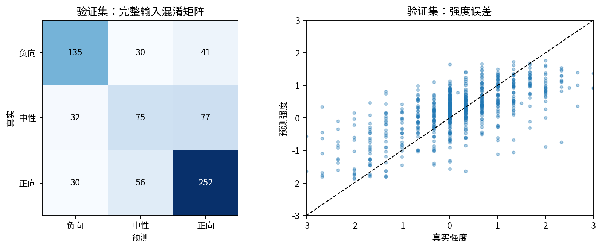
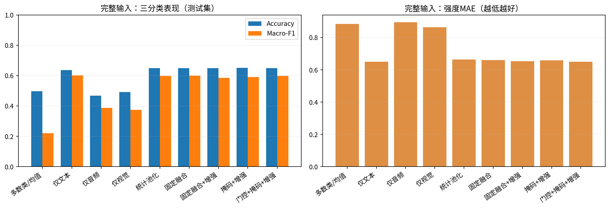
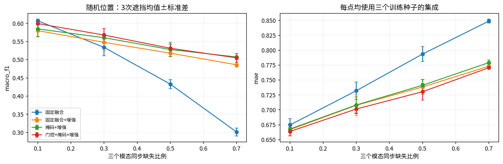
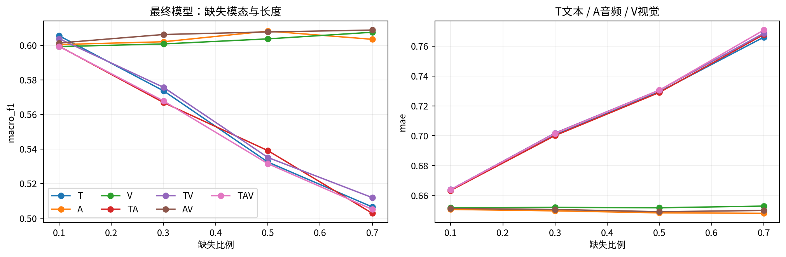
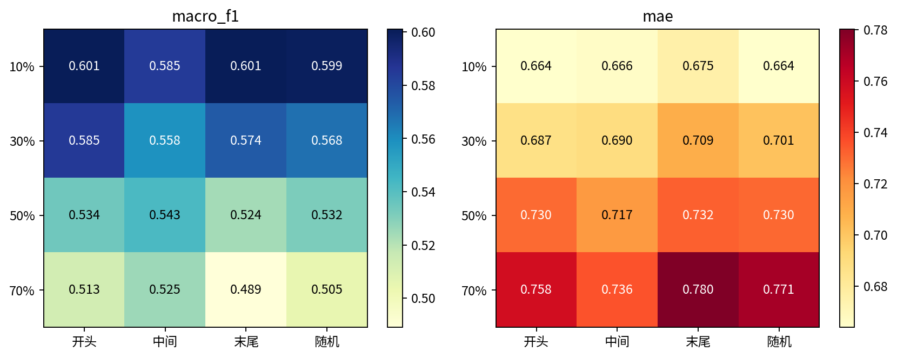
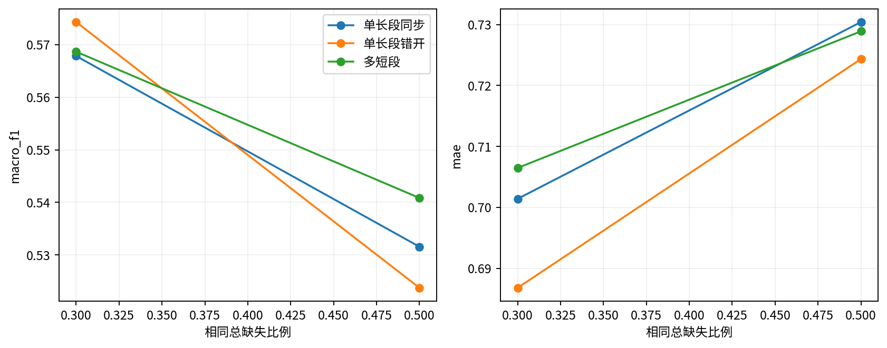
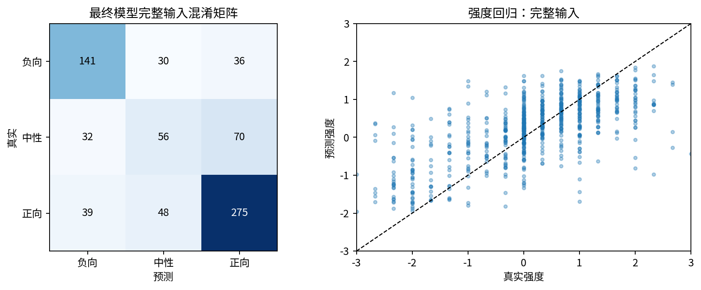
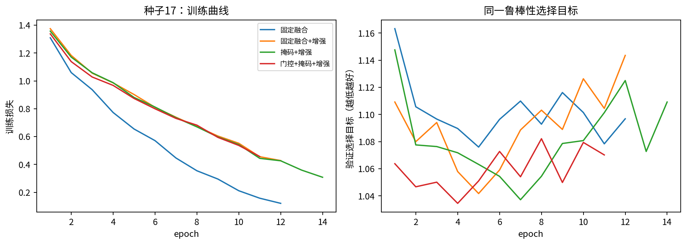

# 问题二实验报告

## 1. 结论与任务完成情况

按照原题的三分类极性与连续强度目标，完成了统一数据接口、8类学习模型、主线4种结构各3种子拟合、验证集选择、留出测试压力实验和附件3全部30条预测。最终选择 **门控+掩码+增强（`gated_aug`）的三个种子集成**。选择发生在测试评价之前，依据及权重哈希见 `selection_lock.json`。

完整输入测试集727条：Accuracy **0.6492**，Macro-F1 **0.5989**，MAE **0.6512**，Pearson **0.6546**。三个模态同步缺失50%、随机位置的三次遮挡平均：Macro-F1 **0.5316**、MAE **0.7304**。对应干净训练固定融合为 0.4328、0.7936。

专项结果已写入 [附件3_问题二预测.csv](results/附件3_问题二预测.csv)。附件3没有标签，不能据此声称专项准确率。本轮不进入问题三。

## 2. 数据、接口与约束

附件2使用对齐版，训练3395、验证728、测试727；类别0/1/2分别是负向/中性/正向。全部4850条与 `label.xlsx` 的强度及划分吻合，源视频在三个划分之间无交叉。`text_bert` 与冻结编码器重新分词的token ID全量一致。审计详见 [data_audit.json](results/data_audit.json)。

附件3缺少预计算 `text`，因此三个划分及专项输入均由同一个冻结DistilBERT编码。音频74维、视觉35维沿用附件数据；不赋予未公开维度凭空推测的物理意义。该通用模型名称、精确修订、哈希及官方来源记录在[代码说明](代码说明.md)。不使用外部情感标注集，也不将问题一生成的特征混入训练。

有效词槽 `P` 排除CLS、SEP、尾部padding；`O` 表示范围内的可用观测；人工删除mask单独保存。文本删除先作用于token和attention，再重算上下文，行为测试确认被删除词无法泄露。音视频全零行视为不可用，但不是已知人工缺失。训练集有效范围内音频可用率约99.92%、视觉约94.47%，不能把整个50槽张量的零行比例当作缺失率。

附件3出现 131 个UNK token；统一按词义不可恢复处理，不反查原文本，也不把UNK来源臆断为某种故障。专项有效范围不确定的样本数为 0。其可用率见 [专项审阅表](results/附件3_预测审阅.csv)。

缺失时长用有效词槽比例表示，不是秒。人工删除数为 `max(1,floor(L*r+0.5))`，短样本的实际比例与名义值可能不同；[corruption_audit.csv](results/corruption_audit.csv)记录实际比例。

## 3. 数学模型与求解

完整符号定义、损失推导、掩码规则与鲁棒性边界见 [模型定义.md](模型定义.md)。

对训练集有效、可用的各模态特征拟合均值与标准差：`x̃=(x−μ)/max(σ,10⁻⁴)`，截断到[-8,8]后将不可用位置置零。冻结编码器不更新参数，所有学习参数仅用训练集标签更新。

三个模态分支各投影到64维，再通过两个残差时序卷积层，卷积核3、膨胀率1和2。将时间加权池化与均值池化拼接，投影为64维片段表示 `h_m`。显式掩码版本仅在可观测位置池化，并输入可用比例、最长不可用连续段比例及有效长度比例。固定融合取 `z=(h_T+h_A+h_V)/3`；动态门控取 `β=softmax(g(h_m,q_m))`、`z=Σβ_m h_m`，整段不可用模态不提供内容表示。

融合向量经共享全连接、GELU和dropout得到 `v`，输出 `p=softmax(W_c v+b_c)`、`ŷ=3 tanh(w_rᵀv+b_r)`。最小化类别加权交叉熵与SmoothL1之和，权重按训练集频数的逆平方根计算。分类与回归是两个头，预测可能存在符号分歧；未利用测试标签修正输出。

训练使用AdamW、batch64、初始学习率0.001、weight decay0.001、dropout0.2、最多35轮、早停耐心7轮。增强训练从6个固定随机连续遮挡视图抽样，25%概率使用完整视图；覆盖T/A/V/TA/TV/AV/TAV、10%/30%/50%/70%、开头/中间/末尾/随机及同步/错开删除。该有限增强库控制了重编码成本，不能等价宣称见过所有故障。

单模态与统计池化各1种子；固定融合、增强固定融合、掩码增强、门控增强各3种子。三种子集成平均分类概率与回归输出，不采用测试集阈值。完整配置见 [protocol.json](protocol.json)。

## 4. 验证集选择

统一选择目标是完整输入的 `MAE+1−MacroF1` 权重0.5，T/A/V/TAV各30%缺失及TAV50%缺失五个场景各0.1。越小越好。每次训练先按此目标早停，再比较四组三种子集成。

| 模型 | 验证选择目标 |
| --- | --- |
| 门控+掩码+增强 | 0.9919 |
| 掩码+增强 | 1.0055 |
| 固定融合+增强 | 1.0111 |
| 固定融合 | 1.0354 |

验证集完整输入结果：

| 模型 | accuracy | macro_f1 | mae | pearson |
| --- | --- | --- | --- | --- |
| 仅文本 | 0.6319 | 0.6165 | 0.6044 | 0.6283 |
| 仅音频 | 0.4258 | 0.3737 | 0.8026 | 0.1288 |
| 仅视觉 | 0.4560 | 0.3853 | 0.7853 | 0.2259 |
| 统计池化 | 0.6003 | 0.5797 | 0.6132 | 0.6421 |
| 固定融合 | 0.6346 | 0.6139 | 0.5880 | 0.6637 |
| 固定融合+增强 | 0.6332 | 0.6050 | 0.5911 | 0.6573 |
| 掩码+增强 | 0.6305 | 0.6021 | 0.5852 | 0.6531 |
| 门控+掩码+增强 | 0.6346 | 0.6055 | 0.5784 | 0.6827 |

上述选择只说明在预先确定的候选与验证目标内最优，不证明全体可能模型中的最优性。动态门控是否胜出以表内实测为准。完整输入下的Macro-F1和中性召回没有全面优于其他模型；鲁棒性收益需要与这类代价一并报告，不能将验证综合目标获胜写成所有指标均最优。

验证集错误分组（完整输入）：

| group | n | accuracy | mae | mean_true | mean_pred | signed_bias |
| --- | --- | --- | --- | --- | --- | --- |
| 强负向 | 58 | 0.9138 | 1.0426 | -2.0115 | -0.9788 | 1.0327 |
| 弱负向 | 148 | 0.5541 | 0.6708 | -0.7072 | -0.1790 | 0.5283 |
| 中性 | 184 | 0.4076 | 0.4070 | 0.0000 | 0.2374 | 0.2374 |
| 弱正向 | 266 | 0.6955 | 0.4250 | 0.7331 | 0.5329 | -0.2002 |
| 强正向 | 72 | 0.9306 | 1.0195 | 1.9931 | 0.9739 | -1.0192 |

验证集上平均强度绝对误差最大的分组为 **强负向**（MAE=1.0426）；中性被误判时，更多落入 **正向**（77条）。强负向平均预测向上偏移、强正向向下偏移，表现出强度幅度压缩。连续强度回归与三分类分界并非同一优化目标，弱情感/中性边界混淆需要与强情感幅度误差分别检查。此处是对真实标签与预测的诊断，不断言存在可观测的“模态冲突”真值。验证集最差8条文本、真值、预测和误差见 [validation_representative_errors.csv](results/validation_representative_errors.csv)，全量完整/缺失对照见 [validation_prediction_review.csv](results/validation_prediction_review.csv)。

以下三个验证案例使错误诊断可以回查。评分语义、比较结构属于文本层面的可能原因，未通过模态归因实验验证因果关系；强度低估则可以直接由真值与预测数值确认。

| 类型 | 样本 | 文本 | 真实极性 | 预测极性 | 真实强度 | 预测强度 | 诊断边界 |
| --- | --- | --- | --- | --- | --- | --- | --- |
| 评分表达 | 130456\$_\$3 | (uhh) It's, out of five stars, I would give it a five | 正向 | 负向 | 2.3333 | -0.7410 | 明确的满分评分仍被判错，提示数字评分表达是当前模型的失败类型；不能凭输出断言具体哪个模态导致错误。 |
| 比较结构 | f_ZJ7L14oYQ\$_\$21 | They just so much more convenient than stupid boots that take forever to put on and just aren't comfortable! | 正向 | 负向 | 2.0000 | -0.8871 | 负面词修饰被比较的靴子，整体表达偏正向；预测错误与比较结构处理不足相符，但这只是文本诊断线索。 |
| 强度低估 | 237009\$_\$11 | (umm), it should be rated junk | 负向 | 负向 | -3.0000 | -0.5606 | 核对极性是否正确与强度幅度是否充分，是两个不同的问题；此例用于审查强负向幅度低估。 |

## 5. 留出测试与基线

| 模型 | accuracy | macro_f1 | mae | pearson | neutral_recall |
| --- | --- | --- | --- | --- | --- |
| 多数类/均值 | 0.4979 | 0.2216 | 0.8856 | — | 0.0000 |
| 仅文本 | 0.6369 | 0.6030 | 0.6500 | 0.6567 | 0.4367 |
| 仅音频 | 0.4677 | 0.3885 | 0.8954 | 0.2026 | 0.1582 |
| 仅视觉 | 0.4924 | 0.3750 | 0.8643 | 0.2539 | 0.0633 |
| 统计池化 | 0.6506 | 0.5978 | 0.6641 | 0.6329 | 0.3481 |
| 固定融合 | 0.6492 | 0.6007 | 0.6609 | 0.6582 | 0.3481 |
| 固定融合+增强 | 0.6506 | 0.5847 | 0.6537 | 0.6549 | 0.2722 |
| 掩码+增强 | 0.6520 | 0.5912 | 0.6585 | 0.6494 | 0.2911 |
| 门控+掩码+增强 | 0.6492 | 0.5989 | 0.6512 | 0.6546 | 0.3544 |

Accuracy按三类计算，F1主要采用Macro-F1，同时保存Weighted-F1、每类F1和中性召回。常数回归的Pearson无定义，结果留空。表中四种主模型为三种子集成，其余学习基线为单种子，因此结构消融另提供一致三种子结果，不能将集成收益全归于结构。

压力实验共 217 个输入场景（含完整输入）：7组合×4比例×4位置；随机位置3次、确定位置1次；另比较同总长度多短段以及多模态错开缺失。所有模型共用mask。原始指标见 [test_metrics.csv](results/test_metrics.csv)，按训练种子汇总的消融见 [ablation_seed_summary.csv](results/ablation_seed_summary.csv)。

## 6. 缺失类型、位置、长度与形状

50%随机单连续段缺失，各模态组合的平均表现：

| subset | macro_f1 | mae |
| --- | --- | --- |
| T | 0.5325 | 0.7294 |
| A | 0.6083 | 0.6483 |
| V | 0.6037 | 0.6517 |
| TA | 0.5391 | 0.7290 |
| TV | 0.5351 | 0.7305 |
| AV | 0.6078 | 0.6491 |
| TAV | 0.5316 | 0.7304 |

在该条件下，Macro-F1最低的是 **TAV**，最高的是 **A**。这描述本数据、本模型和本遮挡机制下的敏感性，不是模态的因果贡献。

其中 A、V、AV 的50%删除均值Macro-F1略高于完整输入。这不证明删除信息普遍有益；小幅波动、噪声分支和融合变化都可能有关，不能把“模态越多越好”作为未验证前提。

TAV同步随机缺失由10%增至70%时，Macro-F1从 0.5993 变为 0.5051，MAE从 0.6638 变为 0.7707。Macro-F1随这四档缺失比例单调下降。这说明应同时报告完整输入精度与严重信息损失时的退化，不能把“鲁棒”理解为信息丢失后性能不变。

TAV同步缺失50%时，表现最差的位置为 `end`，最好为 `middle`，Macro-F1相差 0.0189；具体数值与其他比例见图。随机位置报告三次均值，固定位置只做一次确定删除。位置效应不应被外推为原视频某个固定秒数的重要性。

同总缺失比例、TAV场景的连续段形状/同步性比较：

| rate | condition | macro_f1 | mae |
| --- | --- | --- | --- |
| 0.3000 | 单长段同步 | 0.5678 | 0.7014 |
| 0.3000 | 单长段错开 | 0.5743 | 0.6868 |
| 0.3000 | 多短段 | 0.5687 | 0.7065 |
| 0.5000 | 单长段同步 | 0.5316 | 0.7304 |
| 0.5000 | 单长段错开 | 0.5237 | 0.7244 |
| 0.5000 | 多短段 | 0.5408 | 0.7289 |

50%时，多短段相对单长段同步缺失的Macro-F1差值为 +0.0093，错开相对同步的差值为 -0.0078。这些是实测均值差；本实验没有为所有形状对比做多重比较校正，不据微小差值宣称普遍优劣。

多短段通过三个互不相交分区内各删除一段构造；在短序列或高比例情况下，边界相邻的段可能连接。错开场景使用各模态独立起点，并不保证三个区间互不重叠。

## 7. 不确定性与误差归因边界

选中模型相对干净训练固定融合，在TAV50%随机场景的第一个固定遮挡实现上，按源视频分组进行500次配对bootstrap：Macro-F1差值 0.0800，95%区间 [0.0420, 0.1187]；MAE差值 -0.0648，区间 [-0.0967, -0.0357]。F1差值为正、MAE差值为负才表示改善。区间涵盖0时不能据此断言有稳定优势。该区间不合并其他遮挡重复，也不覆盖所有分布外故障。

完整输入的中性召回为 0.3544；具体混淆方向见图。[error_groups.csv](results/error_groups.csv)进一步按真实强度分组，并用but/however/although/though/yet等字符串线索检查转折类文本。该线索仅是可复查的启发式分组，不是人工“讽刺/模态冲突”真值。不能仅凭不透明特征维度或门控权重宣布模型识别了讽刺。

绝对强度误差最大的8条完整输入样本保留在 [representative_errors.csv](results/representative_errors.csv)，全量逐样本记录见 [test_prediction_review.csv](results/test_prediction_review.csv)。应结合类别混淆、强弱情感误差和遮挡前后的变化解释失败，不把单个案例当普遍规律。

## 8. 附件3交付与复现

最终CSV恰好30行，列名 `sample_id,polarity,intensity`；polarity采用negative/neutral/positive。当前预测分布为 `{'positive': 18, 'negative': 6, 'neutral': 6}`。详细审阅文件另外给出三类概率、三种子强度标准差、各模态可用比例与融合权重。专项非中性分类与回归符号分歧有 0 条，保留原双头输出以便核查；中性类别头也可能输出非零连续强度。

概率未经外部校准；种子标准差不是置信区间；融合权重不是问题三要求的归因证据。附件3只用于最终推理，无标签、无专项调参、未从另一个特征版本补全输入。

可复现命令、边界条件、固定编码器哈希及环境说明见 [代码说明.md](代码说明.md)。训练模型权重、标准化统计、锁定文件、日志和实验CSV均已保存。缓存和通用预训练大权重不进入提交压缩包；本轮不生成问题三结果。
