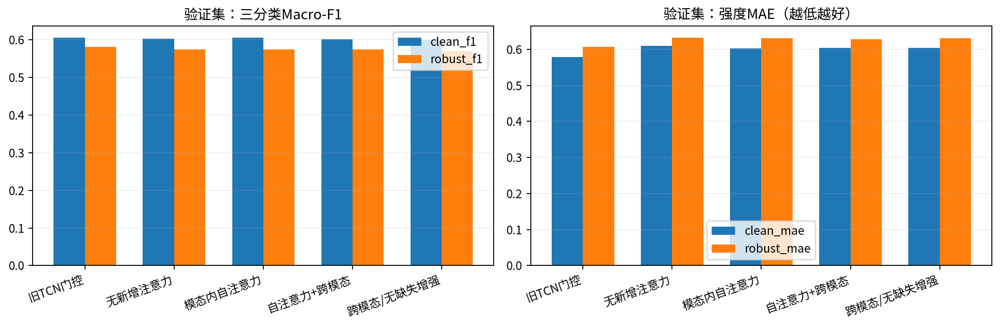
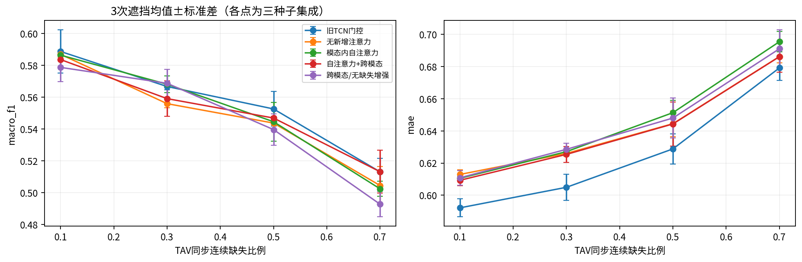
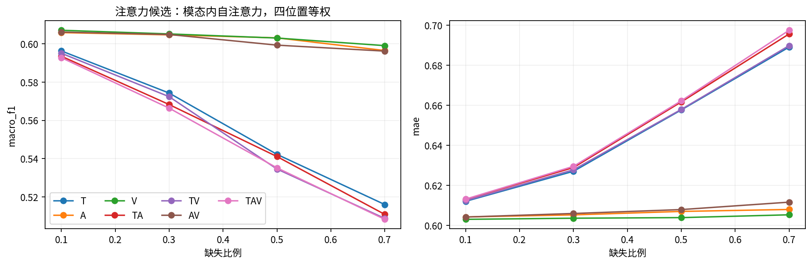
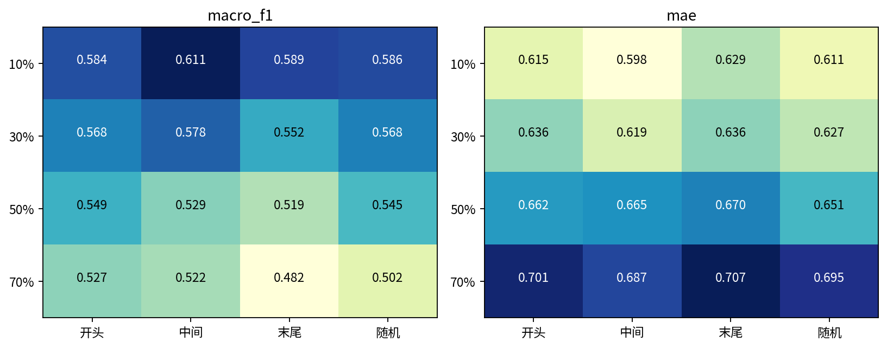
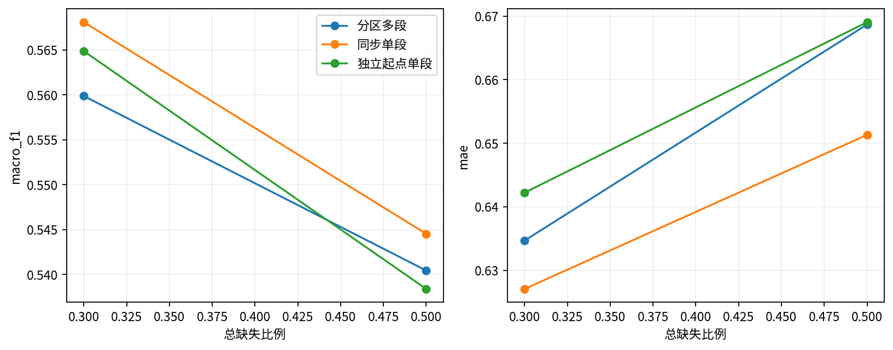
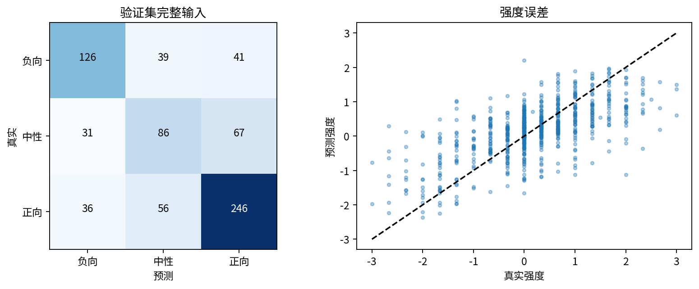
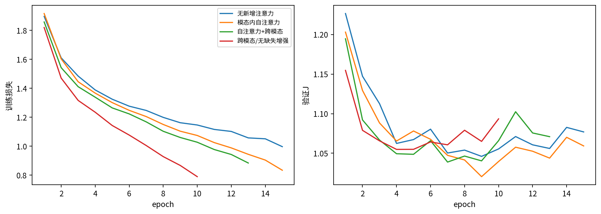
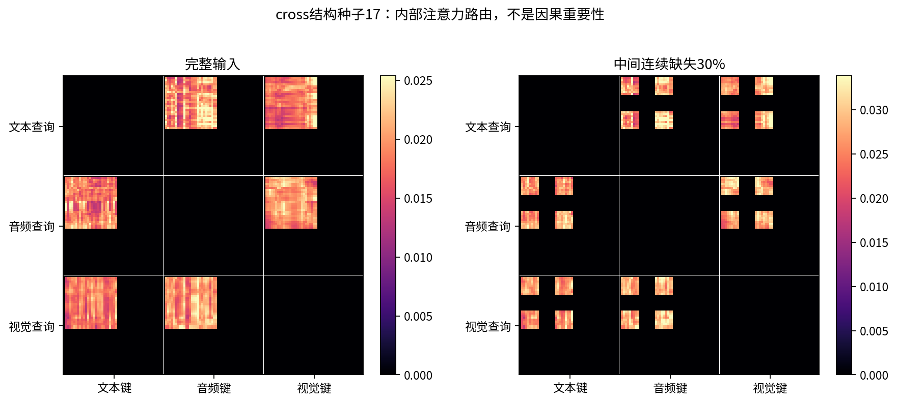

# 问题二注意力实验报告

## 结论

已新建独立目录，完整阅读题目后实现模态内多头自注意力与跨模态注意力，完成4配置×3种子共12次训练、217次输入实现的完整验证、模型锁定后的测试复核和附件3全部30条独立预测。

本轮注意力候选为 **模态内自注意力（self）**，按预注册六场景验证J在增强self/cross中选择。未通过旧版全部七项参考门槛，不建议仅依据本轮结果替换旧版。未通过项：clean_mae, robust_f1, robust_mae, strong_positive。这是对当前轻量参数化和固定训练预算的结论，不能外推成所有注意力机制均有效或均无效。

完整验证集Macro-F1=0.6046、MAE=0.6030；旧版对应为0.6055、0.5784。112个主连续缺失场景的平均Macro-F1=0.5745、MAE=0.6302；旧版为0.5811、0.6067。**建成注意力方案不等于证实其优于旧方案。**

## 题意、输入和模型

问题二必须解决局部连续段缺失，而非只模拟整模态退出；同时预测负向/中性/正向三类和[-3,3]连续强度。真实强度恰为0才是中性。训练3395、验证728、既有测试727；统一aligned_50接口。逐槽缺失和padding区分处理；长度是有效词槽比例，不能当作秒。

附件3没有预计算text，所以所有输入统一经冻结DistilBERT；文本删除在编码前执行，不读取另一版本或原文本补齐。词表对4850条逐一核对一致，源视频划分不交叉。行为检查验证不可观测输入不影响输出、其梯度为0、全空回退有限、跨模态矩阵同模态块为0。缓存复编码最大数值差见 `verification.json`，属于半精度批量编码差异。

结构：三模态投影至64维，加位置/模态编码，分别做4头自注意力；cross进一步用150槽共享4头注意力，让每个查询只访问其他模态的有效键。每块有残差、LayerNorm、128维前馈层。可观测位置均值池化、三分支拼接质量统计，输出分类和3×tanh回归。参考跨模态思想来自[MulT原文](https://aclanthology.org/P19-1656/)，这里不是其完整复现。

完整公式、掩码与边界见[模型定义](模型定义.md)。代码和环境见[代码说明](代码说明.md)。新任务网络的pool对照没有注意力块，但冻结文本编码器仍含注意力，不能声称整个系统完全无注意力。

## 训练与选择规则

新配置均使用AdamW、学习率0.0003、weight decay0.001、dropout0.2、最大batch64、最多30轮、耐心6、种子17/29/43。类别加权交叉熵加2×SmoothL1；该回归系数沿用既有验证设置，不在本轮搜索。pool/self/cross共用由种子、epoch、样本ID确定的动态遮挡；cross_clean只用完整输入。去掉cross块也去掉其前馈层，参数量差异须计入解释。

J为完整输入的MAE+1−MacroF1权重0.5，加五个缺失验证场景各0.1。每个种子分别早停，概率与强度均值集成。旧版是历史参考，训练方式不同，不作为完全同条件结构消融。验证集已被既有实验反复使用，统计区间不校正选择偏差。

## 验证对照与缺失规律

| model | J | clean_accuracy | clean_f1 | clean_mae | clean_pearson | neutral_recall | strong_negative_mae | strong_positive_mae | robust_f1 | robust_mae |
| --- | --- | --- | --- | --- | --- | --- | --- | --- | --- | --- |
| old_gated | 0.9926 | 0.6346 | 0.6055 | 0.5784 | 0.6827 | 0.4076 | 1.0426 | 1.0198 | 0.5811 | 0.6067 |
| pool | 1.0278 | 0.6264 | 0.6029 | 0.6093 | 0.6411 | 0.4457 | 1.0595 | 1.0737 | 0.5737 | 0.6326 |
| self | 1.0181 | 0.6291 | 0.6046 | 0.6030 | 0.6510 | 0.4674 | 1.0109 | 1.0701 | 0.5745 | 0.6302 |
| cross | 1.0254 | 0.6264 | 0.6016 | 0.6039 | 0.6435 | 0.4402 | 1.0939 | 1.0536 | 0.5737 | 0.6283 |
| cross_clean | 1.0298 | 0.6236 | 0.5989 | 0.6039 | 0.6435 | 0.4402 | 1.0541 | 1.0675 | 0.5699 | 0.6306 |

新增可训练网络参数量（不含冻结文本编码器）：

| model | trainable_parameters |
| --- | --- |
| pool | 70084 |
| self | 170500 |
| cross | 203972 |
| cross_clean | 203972 |

同条件新模型差值如下；F1为正、MAE为负表示前者更好。

| comparison | clean_f1 | clean_mae | robust_f1 | robust_mae |
| --- | --- | --- | --- | --- |
| self − pool | 0.0017 | -0.0064 | 0.0008 | -0.0024 |
| cross − self | -0.0030 | 0.0010 | -0.0008 | -0.0019 |
| cross − cross_clean | 0.0027 | 0.0000 | 0.0038 | -0.0024 |

本轮self相对pool的完整输入F1仅小幅变化，集成MAE降低；增加cross块未形成F1和MAE的同步改善。cross相对cross_clean在缺失平均指标上有小幅收益，但幅度不足以追平旧参考。三种子结果存在波动，因此这些小差异仅作为消融观察，不宣称统计显著或机制得到证明。注意力可访问更多剩余位置，并不保证学到有利于本数据泛化的联系。

robust均值先平均一个场景的随机重复，再对112场景等权平均。确定位置1次，随机位置3次；额外多短段/错开实验单列。三种子均值和标准差见 `seed_summary.csv`，不能把训练种子或遮挡重复当独立样本扩大样本量。

TAV缺失比例从10%到70%，四位置等权Macro-F1由0.5927变为0.5083，MAE由0.6132变为0.6975。50%时Macro-F1最低的位置为end，最高为start；不能把槽位置差异外推为原视频秒级重要性。

| rate | condition | macro_f1 | mae |
| --- | --- | --- | --- |
| 0.3000 | 分区多段 | 0.5599 | 0.6347 |
| 0.3000 | 同步单段 | 0.5681 | 0.6271 |
| 0.3000 | 独立起点单段 | 0.5649 | 0.6422 |
| 0.5000 | 分区多段 | 0.5405 | 0.6687 |
| 0.5000 | 同步单段 | 0.5445 | 0.6513 |
| 0.5000 | 独立起点单段 | 0.5384 | 0.6691 |

“独立起点”由各模态分别抽取位置，允许偶然重合，不是强制互不重叠；“分区多段”在三个分区分配删除槽，邻接的片段可能连在一起，短样本按代码规则回退为单段。

这些均值只描述本数据、本随机缺失机制。音视频单独缺失是否略有改善，应视作需要实测的现象，不能预设模态越多越好；也不因一个小差值断言某形状普遍更难。

## 验证错误分析与注意力展示

| group | n | mae | accuracy | true_mean | pred_mean |
| --- | --- | --- | --- | --- | --- |
| 强负向 | 58 | 1.0109 | 0.8966 | -2.0115 | -1.0618 |
| 弱负向 | 148 | 0.6630 | 0.5000 | -0.7072 | -0.2144 |
| 中性 | 184 | 0.3894 | 0.4674 | 0.0000 | 0.1323 |
| 弱正向 | 265 | 0.4998 | 0.6830 | 0.7302 | 0.4680 |
| 强正向 | 73 | 1.0701 | 0.8904 | 1.9863 | 0.9433 |

强情感分组的真实均值与预测均值用于核查幅度收缩；中性准确率单列，避免总体分数掩盖中性类别表现。10条最大绝对误差保存在 `representative_errors.csv`，全量真值、原文和预测在 `validation_prediction_review.csv`。原文仅用于错误审阅。组差异是误差诊断证据，不能据此证明跨模态因果冲突。

当前强负向组的平均真实强度约−2.01，预测约−1.06；强正向组约1.99，预测约0.94。两组分类准确率均接近89%，但MAE超过1：模型通常能判断方向，却低估情感幅度，这是本轮回归不足的直接表现。中性召回由旧版的0.408上升为0.467，也说明不同子指标的取舍不能仅由一个总分概括。

注意力展示固定使用验证集第一条、cross种子17，比较完整输入与中间TAV30%缺失。若最终候选为self，此图明确属于cross对照。黑色同模态块和不可用连接由合法掩码决定；其余颜色是内部权重，不是情感贡献大小。本轮不进行问题三归因。

## 锁定后的既有测试复核

| model | accuracy | macro_f1 | mae | pearson | neutral_recall |
| --- | --- | --- | --- | --- | --- |
| old_gated | 0.6492 | 0.5989 | 0.6512 | 0.6546 | 0.3544 |
| self | 0.6602 | 0.6131 | 0.6664 | 0.6381 | 0.3797 |

TAV50%随机连续缺失三次均值：

| model | macro_f1 | mae |
| --- | --- | --- |
| old_gated | 0.5365 | 0.7340 |
| self | 0.5519 | 0.7473 |

该测试集以前已用于其他方案，因此不是全新独立测试；本轮仅在验证选择锁定后计算，不再按这些分数调参。以下为源视频聚类500次配对bootstrap，差值=注意力−旧版；F1正向、MAE负向才是改善。这里只展示两个固定输入实现的区间，不保证覆盖所有故障。

| split | condition | metric | delta | lower | upper |
| --- | --- | --- | --- | --- | --- |
| valid | clean | macro_f1 | -0.0009 | -0.0235 | 0.0221 |
| valid | clean | mae | 0.0246 | 0.0034 | 0.0447 |
| valid | TAV_r50_random | macro_f1 | 0.0026 | -0.0271 | 0.0318 |
| valid | TAV_r50_random | mae | 0.0167 | -0.0017 | 0.0343 |
| test | clean | macro_f1 | 0.0142 | -0.0136 | 0.0419 |
| test | clean | mae | 0.0152 | -0.0034 | 0.0354 |
| test | TAV_r50_random | macro_f1 | 0.0145 | -0.0138 | 0.0451 |
| test | TAV_r50_random | mae | 0.0181 | -0.0003 | 0.0370 |

本轮完整验证输入的MAE差值区间位于0以上，支持“当前注意力候选回归更差”的判断；完整输入F1区间包含0。既有测试上的F1点估计虽高于旧版，区间仍包含0，不能据此断言分类提升可靠。这些判断限定于当前数据划分和固定比较，仍受前述重复选择影响。

## 附件3与交付

`附件3_注意力模型预测.csv`包含全部30条，字段sample_id,polarity,intensity。分布为{'positive': 17, 'neutral': 8, 'negative': 5}。这是新注意力候选的独立结果，既有采用文件未被覆盖。附件3无标签，不能给出专项准确率；分类/回归是两个头，非中性符号分歧有0条，中性预测也可能有非零连续强度。

代码、参数、协议、环境、全部训练记录、验证/测试矩阵、注意力可视化与结果审阅页均保留。通用预训练权重与大型可重建缓存不进入交付包；复现入口见代码说明。
