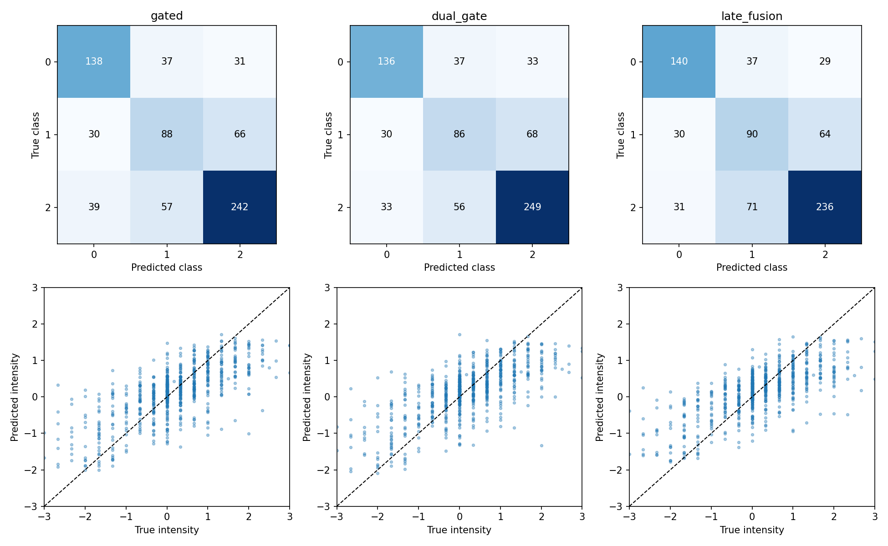
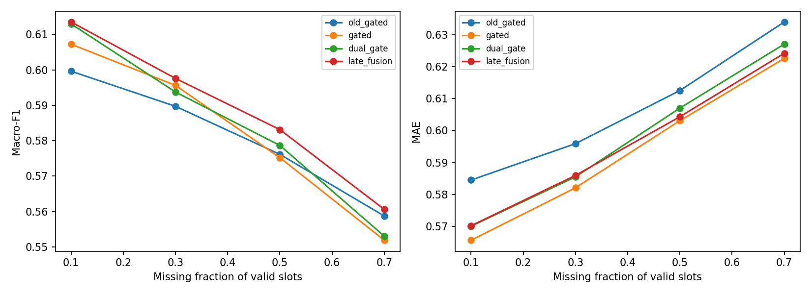

# 问题二任务独立融合实验报告

两种候选均未通过全部原验收条件，保留旧版 old_gated；本轮不追加模型或调参。

## 1. 范围与诊断结论

训练3395、验证728，沿用aligned_50输入、冻结DistilBERT、动态连续删除和真实强度0为中性。只修改任务融合方式，没有恢复v3，没有新增序数、蒸馏、表示分解或调参搜索。

诊断发现训练与验证存在差距；音视频都能记忆96条训练样本；抽查梯度大多同向，因此没有把任务冲突当成既定原因。真值oracle显示部分救错机会，但其数值不可部署，不能当成模型收益。详细证据见[瓶颈诊断报告](问题二瓶颈诊断报告.md)。

## 2. 两种候选

**A / dual_gate**：只增加一套与原门控复制初始化的回归门控；分类、回归分别加权三模态特征，再进入同一个共享MLP和各自预测头。共有参数初始化与基线一致，评估模式下初始预测完全一致。主干和MLP仍共享，因此不声称完全消除了任务冲突。训练时两个流各自经过dropout，不声称与原基线随机轨迹逐位相同。[任务独立门控研究](https://research.google/pubs/modeling-task-relationships-in-multi-task-learning-with-multi-gate-mixture-of-experts/)

**B / late_fusion**：冻结同种子文本、音频、视觉专家，每个任务仅训练9→16→3、GELU门控，输入仅为三模态质量特征。输出层权重为0，偏置log(0.8,0.1,0.1)。分类混合概率，回归混合连续预测，不重复施加tanh。只有422个可训练参数，但部署还包含三个专家；9次既有专家训练的轮数和时间单列在 `expert_pretraining_cost.csv`，不声称总算力更低。

B缓存绑定全部实际输入数组、观测掩码、专家权重哈希、编码器版本和标准化统计。专家保持eval且参数冻结；归一化排除缺席模态，全缺失回退训练先验和均值。回归是可用专家预测的凸组合，无法超出其数值范围。专家曾在同一训练集拟合，门控并非OOF堆叠，报告不掩盖这一泛化限制。

## 3. 训练与选择

两个候选各种子17/29/43，共6次正式拟合。继承v2遮挡、AdamW学习率0.001、batch64、weight decay0.001、梯度裁剪5、20/15轮上限、耐心5、两阶段重置优化器和余弦调度。损失为训练类别加权分类损失＋2×SmoothL1。每轮额外评价固定512条训练子集，但检查点仅按六场景验证J选择。以下为集成结果：

| model | J | parameters | clean_f1 | clean_mae | robust_f1 | robust_mae | neutral_recall | strong_negative_mae | strong_positive_mae |
|---|---|---|---|---|---|---|---|---|---|
| old_gated | 0.9926 | 163816 | 0.6055 | 0.5784 | 0.5811 | 0.6067 | 0.4076 | 1.0426 | 1.0198 |
| text | 0.9796 | 89638 | 0.6215 | 0.5702 | 0.5871 | 0.6032 | 0.5000 | 0.9667 | 1.0619 |
| gated | 0.9697 | 163816 | 0.6214 | 0.5579 | 0.5825 | 0.5934 | 0.4783 | 0.9945 | 1.0699 |
| dual_gate | 0.9702 | 166025 | 0.6231 | 0.5603 | 0.5846 | 0.5974 | 0.4674 | 1.0264 | 1.1075 |
| late_fusion | 0.9712 | 178008 | 0.6223 | 0.5633 | 0.5887 | 0.5962 | 0.4891 | 1.0952 | 1.1504 |

完整矩阵217次输入实现，其中112个主场景先平均随机重复再等权汇总。六场景早停J与完整矩阵缺失均值是不同统计量，不混淆。

原七项门槛相对历史old_gated保持不变：完整F1下降≤0.005、MAE增加≤0.01；缺失平均F1至少增加0.01且MAE不升；中性召回下降≤0.01；强正、强负MAE分别增加≤0.02。全部通过才按J选，差距<0.002优先部署总参数少者。

- dual_gate：未通过 robust_f1, strong_positive
- late_fusion：未通过 robust_f1, strong_negative, strong_positive

`seed_summary.csv` 分开给出三种子指标均值、样本标准差和集成，避免把集成收益归因于结构。完整分类与回归指标如下：

| model | accuracy | macro_f1 | weighted_f1 | mae | pearson | neutral_recall | f1_negative | f1_neutral | f1_positive | strong_negative_mae | strong_positive_mae |
|---|---|---|---|---|---|---|---|---|---|---|---|
| old_gated | 0.6346 | 0.6055 | 0.6300 | 0.5784 | 0.6827 | 0.4076 | 0.6700 | 0.4348 | 0.7119 | 1.0426 | 1.0198 |
| text | 0.6374 | 0.6215 | 0.6406 | 0.5702 | 0.6951 | 0.5000 | 0.6897 | 0.4730 | 0.7020 | 0.9667 | 1.0619 |
| gated | 0.6429 | 0.6214 | 0.6426 | 0.5579 | 0.7006 | 0.4783 | 0.6683 | 0.4809 | 0.7149 | 0.9945 | 1.0699 |
| dual_gate | 0.6470 | 0.6231 | 0.6459 | 0.5603 | 0.6944 | 0.4674 | 0.6716 | 0.4738 | 0.7238 | 1.0264 | 1.1075 |
| late_fusion | 0.6401 | 0.6223 | 0.6423 | 0.5633 | 0.7023 | 0.4891 | 0.6880 | 0.4712 | 0.7076 | 1.0952 | 1.1504 |

## 4. 中性、强情感与错误案例

| model | group | n | accuracy | mae | true_mean | pred_mean | saturation_fraction |
|---|---|---|---|---|---|---|---|
| gated | strong_negative | 58 | 0.8966 | 0.9945 | -2.0115 | -1.0460 | 0.0000 |
| gated | neutral | 184 | 0.4783 | 0.3306 | 0.0000 | 0.1101 | 0.0000 |
| gated | strong_positive | 73 | 0.9452 | 1.0699 | 1.9863 | 0.9164 | 0.0000 |
| dual_gate | strong_negative | 58 | 0.8966 | 1.0264 | -2.0115 | -1.0001 | 0.0000 |
| dual_gate | neutral | 184 | 0.4674 | 0.3328 | 0.0000 | 0.1356 | 0.0000 |
| dual_gate | strong_positive | 73 | 0.9452 | 1.1075 | 1.9863 | 0.8788 | 0.0000 |
| late_fusion | strong_negative | 58 | 0.9138 | 1.0952 | -2.0115 | -0.9167 | 0.0000 |
| late_fusion | neutral | 184 | 0.4891 | 0.3226 | 0.0000 | 0.1707 | 0.0000 |
| late_fusion | strong_positive | 73 | 0.9315 | 1.1504 | 1.9863 | 0.8359 | 0.0000 |

类别0/1/2为负向/中性/正向。每个新候选的12条最大绝对误差案例见 `representative_errors.csv`；完整样本审阅见 `validation_prediction_review.csv`。原文只用于审阅，不用于补齐输入。组均值收缩或单个案例不能直接确定误差因果来源。

## 5. 缺失与门控

类型、位置、比例见 `missing_effects.csv`。多短段和错开实验按相同模态组合、比例、重复配对，差值为目标场景减单段同步场景：

| model | comparison | pairs | delta_f1 | delta_mae |
|---|---|---|---|---|
| old_gated | multi | 24 | -0.0044 | 0.0116 |
| old_gated | staggered | 24 | 0.0019 | 0.0057 |
| text | multi | 24 | -0.0031 | 0.0089 |
| text | staggered | 24 | 0.0029 | 0.0045 |
| gated | multi | 24 | 0.0005 | 0.0057 |
| gated | staggered | 24 | 0.0001 | 0.0038 |
| dual_gate | multi | 24 | -0.0043 | 0.0083 |
| dual_gate | staggered | 24 | -0.0023 | 0.0029 |
| late_fusion | multi | 24 | -0.0045 | 0.0096 |
| late_fusion | staggered | 24 | 0.0020 | 0.0049 |

完整输入下两套任务门控的三种子、全样本平均如下；全缺失样本的零权重也计入均值。它们只描述模型内部路由，不能当作问题三的因果解释。

| model | classification_T | classification_A | classification_V | regression_T | regression_A | regression_V |
|---|---|---|---|---|---|---|
| dual_gate | 0.6632 | 0.1523 | 0.1846 | 0.4299 | 0.2890 | 0.2811 |
| late_fusion | 0.9143 | 0.0385 | 0.0472 | 0.8373 | 0.0499 | 0.1128 |

## 6. 配对统计与结论边界

按239个源视频进行1000次配对bootstrap。F1差为正更好，MAE差为负更好。以下相对同条件gated；相对old_gated也已保存。区间跨0不宣称稳定优势。验证集被重复使用，区间未校正模型选择，不能视作独立泛化保证。

| reference | model | condition | metric | delta | lower | upper |
|---|---|---|---|---|---|---|
| gated | dual_gate | clean | macro_f1 | 0.0017 | -0.0262 | 0.0289 |
| gated | dual_gate | clean | mae | 0.0024 | -0.0098 | 0.0153 |
| gated | dual_gate | continuous_average | macro_f1 | 0.0021 | -0.0134 | 0.0165 |
| gated | dual_gate | continuous_average | mae | 0.0041 | -0.0051 | 0.0142 |
| gated | late_fusion | clean | macro_f1 | 0.0009 | -0.0254 | 0.0264 |
| gated | late_fusion | clean | mae | 0.0054 | -0.0098 | 0.0217 |
| gated | late_fusion | continuous_average | macro_f1 | 0.0062 | -0.0121 | 0.0239 |
| gated | late_fusion | continuous_average | mae | 0.0028 | -0.0100 | 0.0167 |

没有候选通过，因此按计划没有运行新的测试集复核，没有生成重复附件3预测，没有制作新联合包。沿用 v2 中的旧版最终模型及已验证交付。

本轮的有效结论是对这两种明确参数化、固定训练预算下的候选进行比较，不能外推为所有任务独立融合或所有后融合方法均有效／无效。冻结文本编码器、仅使用质量特征路由、专家回归范围和数据规模都构成适用边界。

## 7. 交付与复现

交付本目录的模型、配置、诊断、6个候选检查点、训练记录、比较表、错误案例、审阅页和行为核验。外部仍为text_bert/audio/vision输入，标准预测字段sample_id,polarity,intensity；新增两套门控仅供内部审计。旧版、v2、问题三及根Python环境保持不变。完整复现入口见[代码说明](代码说明.md)。
