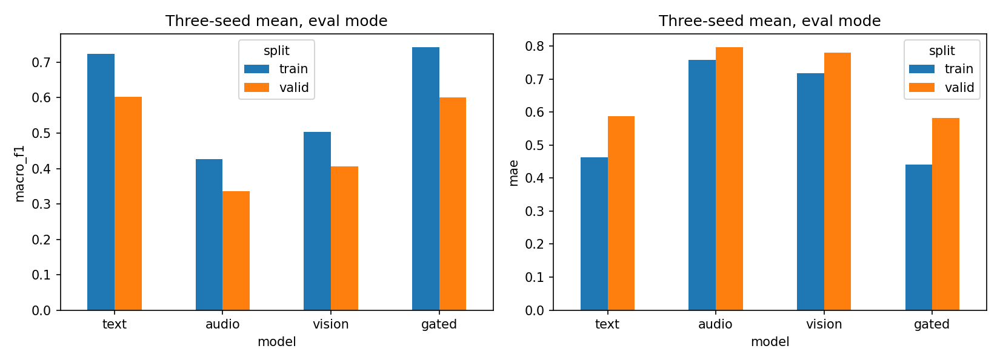
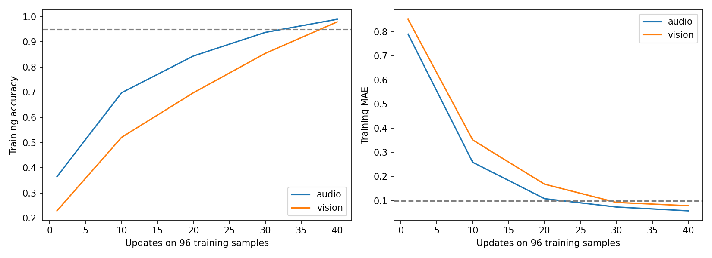

# 问题二瓶颈诊断报告

本轮先完成输入与行为检查，再进行诊断，最后才启动两种候选结构的正式训练。未发现标签、源视频划分、接口或人工掩码错误；具体断言见 `results/verification.json`。诊断只使用训练和验证材料，不使用专项测试集选择方法。

## 1. 训练表现与泛化差距

对v2文本、音频、视觉、门控模型各三个最佳检查点，在完整训练3395条和验证728条上统一使用评估模式。以下为三个单模型指标均值，不是集成指标，不能与集成F1直接混用。

| model | split | accuracy | macro_f1 | mae | neutral_recall |
|---|---|---|---|---|---|
| audio | train | 0.5368 | 0.4262 | 0.7590 | 0.1148 |
| audio | valid | 0.4386 | 0.3367 | 0.7971 | 0.0670 |
| gated | train | 0.7703 | 0.7431 | 0.4411 | 0.5893 |
| gated | valid | 0.6223 | 0.6008 | 0.5829 | 0.4583 |
| text | train | 0.7461 | 0.7245 | 0.4622 | 0.6139 |
| text | valid | 0.6181 | 0.6024 | 0.5874 | 0.4946 |
| vision | train | 0.5794 | 0.5040 | 0.7180 | 0.2155 |
| vision | valid | 0.4684 | 0.4054 | 0.7806 | 0.1721 |

门控和文本模型在训练集上明显优于验证集，提供了泛化差距的直接观测。最佳检查点早并非判断过拟合的唯一依据；这里仍无法排除源视频分布差异等原因，也不据此宣称加大模型能解决问题。原检查点阶段和实际训练轮数见 `historical_stages.csv`。

## 2. 96条小样本记忆检查

种子17，从训练集中同时具有音视频观测的样本按三类各抽32条。两分支使用同一96条样本；随机初始化现有单模态结构，关闭dropout，AdamW学习率0.001、weight decay=0、梯度裁剪5，最多300次更新，每10次检查一次，达到准确率≥0.95且MAE≤0.1即停止。分类权重仍按完整训练集频数计算。诊断模型不保存为正式候选，也不参与选择。

| model | steps | passed | accuracy | mae | macro_f1 |
|---|---|---|---|---|---|
| audio | 40 | True | 0.9896 | 0.0577 | 0.9896 |
| vision | 40 | True | 0.9792 | 0.0789 | 0.9792 |

两个分支均能记住这一组样本，因此当前低验证性能不能简单归咎于网络完全没有拟合能力。记忆小样本并不证明音视频能跨视频泛化，也不能证明这些特征存在足够情感信号。

## 3. 互补性与融合损害

使用已有三个单模态集成和门控集成的验证预测。只将实际可观测专家计入救错和逐样本最小误差；每一行都使用对应缺失场景的观测掩码。完整输入如下：

| group | n | text_wrong | text_wrong_rescued | rescue_fraction | text_correct | text_correct_harmed | harm_fraction | text_mae | oracle_available_mae |
|---|---|---|---|---|---|---|---|---|---|
| all | 728 | 264 | 138 | 0.5227 | 464 | 49 | 0.1056 | 0.5702 | 0.3942 |
| neutral | 184 | 92 | 13 | 0.1413 | 92 | 21 | 0.2283 | 0.3676 | 0.1253 |
| strong_negative | 58 | 6 | 5 | 0.8333 | 52 | 1 | 0.0192 | 0.9667 | 0.9446 |
| strong_positive | 73 | 7 | 7 | 1.0000 | 66 | 0 | 0.0000 | 1.0619 | 0.9832 |

`rescue_fraction` 是文本出错时、音频或视觉至少一个预测正确的比例；`harm_fraction` 是文本正确但门控预测错误的比例。`oracle_available_mae` 使用真值逐样本挑选误差最小的可用专家，全部缺失时回退训练均值。这些oracle指标是乐观参照，不是可部署模型；救错可能包含随机命中和类别偏好，不能凭该比例证明存在可学习、稳定的互补性。

以下缺失类型汇总先平均随机重复，再平均各比例与位置。完整逐场景和中性、强正负向分组见 `complementarity.csv`。

| subset | group | rescue_fraction | harm_fraction | text_mae | oracle_available_mae | oracle_accuracy |
|---|---|---|---|---|---|---|
| A | all | 0.5282 | 0.1134 | 0.5702 | 0.3938 | 0.8289 |
| AV | all | 0.5257 | 0.1117 | 0.5702 | 0.3957 | 0.8280 |
| T | all | 0.5612 | 0.1515 | 0.6280 | 0.4453 | 0.8117 |
| TA | all | 0.5663 | 0.1502 | 0.6280 | 0.4451 | 0.8140 |
| TAV | all | 0.5567 | 0.1452 | 0.6280 | 0.4481 | 0.8101 |
| TV | all | 0.5557 | 0.1467 | 0.6280 | 0.4487 | 0.8095 |
| V | all | 0.5220 | 0.1061 | 0.5702 | 0.3957 | 0.8267 |

## 4. 分类与回归梯度

固定512条训练样本，8批×64；三个门控检查点，各自检查完整输入和固定种子17/轮次1动态遮挡。关闭dropout，参数不更新；比较分类交叉熵与2×SmoothL1对共享分支、共享门控的梯度。范数比为分类梯度范数除以加权回归梯度范数；零梯度单独标记，余弦不作解释，分母为零时不定义范数比。

| condition | block | batches | mean_cosine | negative_fraction | zero_gradient_batches | mean_norm_ratio |
|---|---|---|---|---|---|---|
| clean | branches | 24 | 0.4980 | 0.0000 | 0 | 0.8827 |
| clean | gate | 24 | 0.5330 | 0.0833 | 0 | 0.8934 |
| dynamic | branches | 24 | 0.5477 | 0.0000 | 0 | 0.8644 |
| dynamic | gate | 24 | 0.5793 | 0.0000 | 0 | 0.9229 |

在这些检查点和抽样批次上，梯度大多同向，没有证据支持“普遍的梯度冲突是主要瓶颈”。这不是证明任意训练时刻都没有冲突，也不排除分类与回归需要不同模态权重。本轮不使用PCGrad或其他梯度修正。[相关研究](https://arxiv.org/abs/2001.06782)

## 5. 强情感收缩与输出饱和

强负向定义为真实强度≤−1.5，强正向为真实强度≥1.5；弱情感为其余非零强度，中性严格为0。饱和诊断阈值固定为预测绝对值≥2.9，属于分析指标而非决策阈值。下表为三个单模型的组均值和分位数均值。

| model | group | n | true_mean | pred_mean | saturation_fraction | pred_q10 | pred_q50 | pred_q90 |
|---|---|---|---|---|---|---|---|---|
| audio | strong_negative | 58.0000 | -2.0115 | 0.0145 | 0.0000 | -0.4248 | 0.0311 | 0.5020 |
| audio | strong_positive | 73.0000 | 1.9863 | 0.1913 | 0.0000 | -0.1712 | 0.1876 | 0.5730 |
| gated | strong_negative | 58.0000 | -2.0115 | -1.0460 | 0.0000 | -1.8832 | -1.1379 | -0.1254 |
| gated | strong_positive | 73.0000 | 1.9863 | 0.9164 | 0.0000 | 0.2924 | 0.9479 | 1.5898 |
| text | strong_negative | 58.0000 | -2.0115 | -1.0796 | 0.0000 | -1.9125 | -1.1819 | -0.1053 |
| text | strong_positive | 73.0000 | 1.9863 | 0.9376 | 0.0000 | 0.2905 | 0.9074 | 1.7815 |
| vision | strong_negative | 58.0000 | -2.0115 | -0.1023 | 0.0000 | -0.6339 | -0.1268 | 0.4470 |
| vision | strong_positive | 73.0000 | 1.9863 | 0.3851 | 0.0000 | -0.1256 | 0.3974 | 0.8770 |

平均预测向中间收缩不等于输出已经饱和。缺乏输出饱和证据时，不把误差简单归因于3×tanh，也不临时换输出函数。本轮保留连续回归目标和真实中性定义。

## 6. 对后续实验的约束

诊断支持继续进行已约定的两个有限对照：任务独立门控和冻结专家后融合。它没有证明其中任何一种必然改善，也不作为追加模块或扩大搜索的理由。全部行为检查通过，诊断完成标记绑定协议哈希；正式模型只按验证集与原七项门槛选择。
