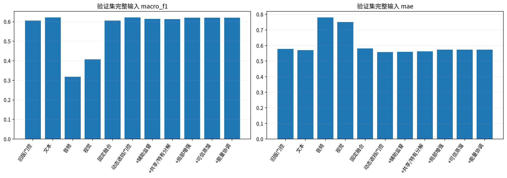
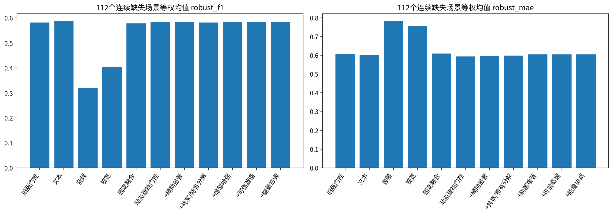
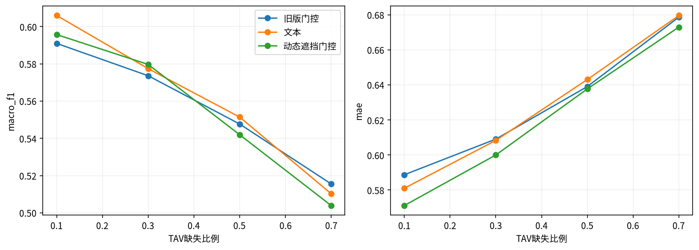
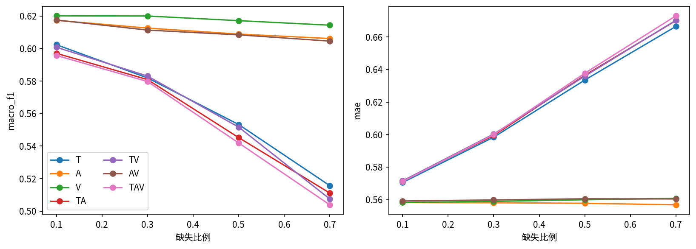
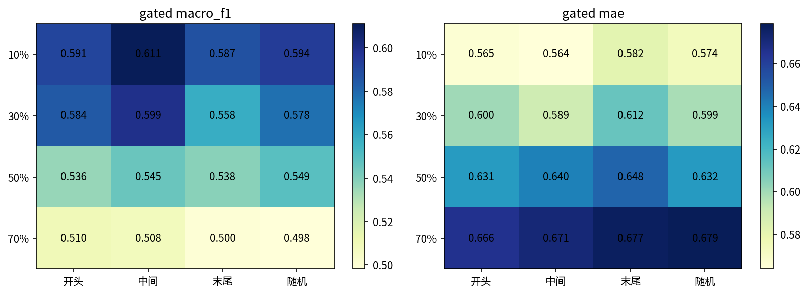
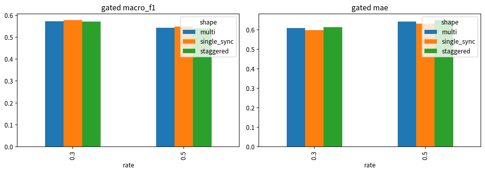
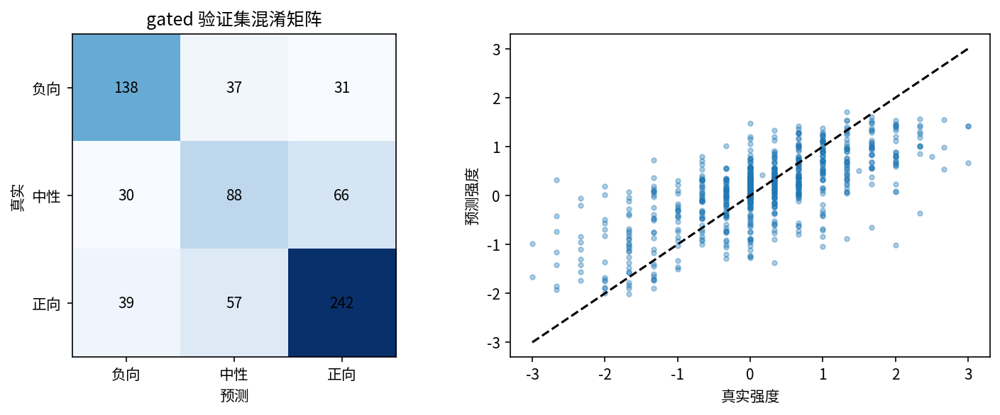
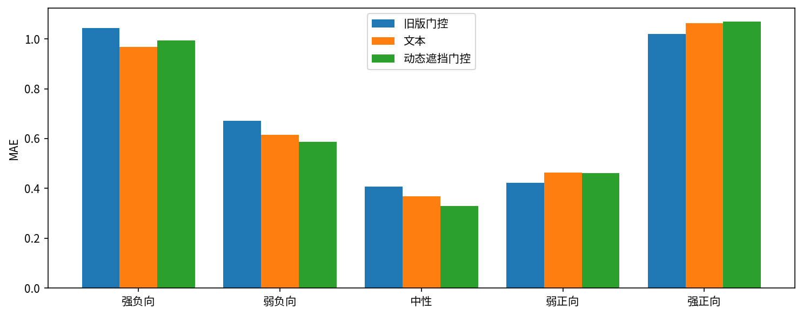
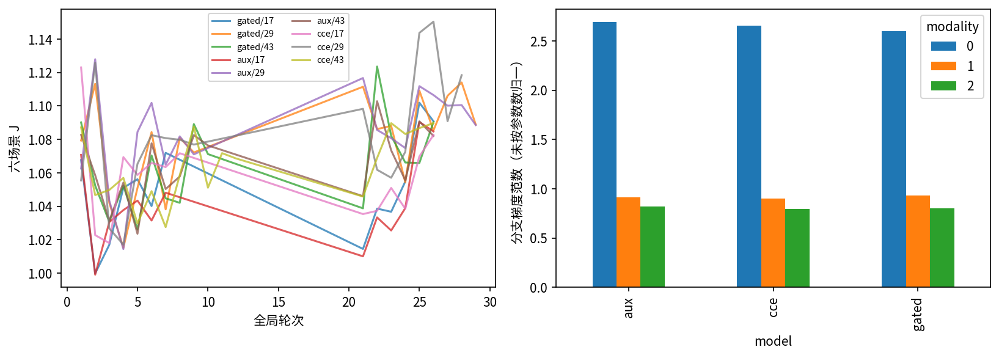

# 问题二优化实验报告

## 1. 结论

本轮新模型未通过全部预注册验收条件，最终保留旧版门控模型。新增实验作为研究结果保存，不将其宣称为已验证的整体性能提升。

最终提交模型：**old_gated**；重点审查的新模型：**gated**。选择仅依据验证集，完整规则与权重哈希保存在 `selection_lock.json`。附件3共30条预测，无标签，不能计算专项准确率。

## 2. 原题约束与实施范围

统一使用附件2对齐版：训练3395、验证728、测试727。文本采用同一冻结 DistilBERT；音频74维、视觉35维。只使用赛题数据学习参数。文本删除发生在编码之前，不调用原文或其他版本补齐。有效位置、原始可用性、人工删除分别记录；时长单位是有效词槽比例。分类为负向/中性/正向，中性真实强度恰为0，保留分类与强度两个预测头。

本轮在独立目录实施，未重训或替换问题三。根环境未安装、升级或重装依赖。旧版比较接口也统一采用全模态无观测时的训练先验兜底；旧权重及原文件不变。验证集4条单词槽样本可触发此边界，因此本报告旧版鲁棒指标与历史原始实现可能有微小差异；测试集没有单词槽样本。

为降低完整压力测试的时间成本，推理可使用代数等价的FP32展开卷积。每个模型先通过float64公式校验与六个验证输入的数值比较：最大差≤1e-3、集成类别无变化才启用，否则保留原cuDNN。后端选择不依据真实标签，审计见 `backend_*.json`。训练及六场景J仍采用原执行方式；不能把这项工程优化称为模型精度提升，也不宣称不同后端位级一致。

## 3. 模型与受控实验

动态连续遮挡每样本50%完整、50%遮挡，由种子、轮次、样本编号确定。7种模态组合、4种比例、4种位置均匀抽样，多模态同步/独立起点各一半。同一训练种子下所有模型共用遮挡；两个阶段最多20/15轮，早停耐心5。回归损失权重在种子17的三组门控实验后锁定为 **2.0**。

十个主配置均使用17、29、43三个种子。新增模块依次为单模态辅助监督、共享/特有分解、局部互补增强、可信分类蒸馏、能量协调。最佳新候选不含五个新增EBMC模块，逐项移除清单为空；五项累加对照全部完成，不将不适用的消融宣称为额外实验。具体公式、训练权重、特殊情况见《模型定义.md》。采用全程最佳验证检查点；若第一阶段检查点更好，允许最终保留第一阶段，不能声称第二阶段模块必然生效。

这是借鉴 [EBMC](https://arxiv.org/html/2604.12518v2) 的本题适配：使用连续区间缺失、冻结统一文本接口、三分类与回归双任务，以及64维时序网络。局部增强只增强可观测位置，不声称恢复真实缺失信号；可信蒸馏只作用于分类，不使用回归教师共识约束。EMC采用范数项梯度正则的简化实现，见[官方实现](https://github.com/kangverse/EBMC/blob/main/EBMC/modules/emc.py)。

## 4. 验证集结果与模型选择

| model | J | clean_f1 | clean_mae | robust_f1 | robust_mae | neutral_recall | eligible |
| --- | --- | --- | --- | --- | --- | --- | --- |
| old_gated | 0.9926 | 0.6055 | 0.5784 | 0.5811 | 0.6067 | 0.4076 | False |
| text | 0.9796 | 0.6215 | 0.5702 | 0.5871 | 0.6032 | 0.5000 | False |
| audio | 1.4629 | 0.3189 | 0.7800 | 0.3207 | 0.7822 | 0.0272 | False |
| vision | 1.3450 | 0.4076 | 0.7508 | 0.4051 | 0.7544 | 0.1467 | False |
| fixed | 0.9946 | 0.6054 | 0.5813 | 0.5776 | 0.6102 | 0.4891 | False |
| gated | 0.9697 | 0.6214 | 0.5579 | 0.5825 | 0.5934 | 0.4783 | False |
| aux | 0.9762 | 0.6147 | 0.5603 | 0.5841 | 0.5958 | 0.4674 | False |
| msd | 0.9777 | 0.6133 | 0.5631 | 0.5815 | 0.5988 | 0.5109 | False |
| cce | 0.9814 | 0.6211 | 0.5741 | 0.5840 | 0.6050 | 0.5109 | False |
| imtd | 0.9814 | 0.6211 | 0.5741 | 0.5840 | 0.6050 | 0.5109 | False |
| emc | 0.9814 | 0.6211 | 0.5741 | 0.5840 | 0.6050 | 0.5109 | False |

候选相对旧版：完整输入Macro-F1变化 +0.0158，MAE变化 -0.0205；连续缺失场景平均Macro-F1变化 +0.0014，MAE变化 -0.0134。分类F1越高越好，MAE越低越好，两者须分别判断。

robust 为112个单连续区间场景等权平均：每场景先平均随机遮挡重复，再对场景平均。额外的多短段与错开实验单独分析，不混入主验收均值。完整评价矩阵含217次输入实现。

完整输入性能：

| model | accuracy | macro_f1 | weighted_f1 | mae | pearson | neutral_recall |
| --- | --- | --- | --- | --- | --- | --- |
| old_gated | 0.6346 | 0.6055 | 0.6300 | 0.5784 | 0.6827 | 0.4076 |
| text | 0.6374 | 0.6215 | 0.6406 | 0.5702 | 0.6951 | 0.5000 |
| audio | 0.4409 | 0.3189 | 0.3763 | 0.7800 | 0.1537 | 0.0272 |
| vision | 0.4794 | 0.4076 | 0.4511 | 0.7508 | 0.2969 | 0.1467 |
| fixed | 0.6250 | 0.6054 | 0.6276 | 0.5813 | 0.6663 | 0.4891 |
| gated | 0.6429 | 0.6214 | 0.6426 | 0.5579 | 0.7006 | 0.4783 |
| aux | 0.6360 | 0.6147 | 0.6349 | 0.5603 | 0.6957 | 0.4674 |
| msd | 0.6291 | 0.6133 | 0.6315 | 0.5631 | 0.6848 | 0.5109 |
| cce | 0.6401 | 0.6211 | 0.6403 | 0.5741 | 0.6803 | 0.5109 |
| imtd | 0.6401 | 0.6211 | 0.6403 | 0.5741 | 0.6803 | 0.5109 |
| emc | 0.6401 | 0.6211 | 0.6403 | 0.5741 | 0.6803 | 0.5109 |

各模型未满足的验收项：

| model | failed |
| --- | --- |
| text | robust_f1, strong_positive |
| audio | clean_f1, clean_mae, robust_f1, robust_mae, neutral, strong_negative, strong_positive |
| vision | clean_f1, clean_mae, robust_f1, robust_mae, neutral, strong_negative, strong_positive |
| fixed | robust_f1, robust_mae, strong_positive |
| gated | robust_f1, strong_positive |
| aux | robust_f1, strong_positive |
| msd | robust_f1, strong_positive |
| cce | robust_f1 |
| imtd | robust_f1 |
| emc | robust_f1 |

全部单种子、集成和逐场景结果在 `validation_metrics.csv`；训练种子均值/标准差在 `ablation_seed_summary.csv`。三种子标准差不是置信区间。音视频利用改善须结合辅助头性能、消融与融合收益判断；梯度范数受分支参数量影响，不能直接证明梯度竞争或因果贡献。

## 5. 缺失类型、位置、长度及形状

以下缺失规律图主要展示候选 **gated**，与最终采用模型明确区分。

在候选模型的本次验证中，按比例和位置等权平均，Macro-F1最低的缺失组合为 TAV（0.5553），最高为 V（0.6179）。该比较是特定遮挡机制下的敏感性结果，不等于模态因果贡献。

| rate | shape | macro_f1 | mae |
| --- | --- | --- | --- |
| 0.3000 | multi | 0.5733 | 0.6094 |
| 0.3000 | single_sync | 0.5775 | 0.5986 |
| 0.3000 | staggered | 0.5711 | 0.6129 |
| 0.5000 | multi | 0.5431 | 0.6416 |
| 0.5000 | single_sync | 0.5490 | 0.6318 |
| 0.5000 | staggered | 0.5408 | 0.6489 |

缺失率按有效词槽计算，短序列取整可能使实际比例偏离名义比例；逐场景实际删除比例见 `valid_corruption_audit.csv`。错开缺失采用独立起点，不保证区间互不重叠；多短段在边界可能连接。不能由一个位置或形状的小幅均值差推断普遍规律。

## 6. 错误归因与强度压缩

| model | group | n | accuracy | mae | mean_true | mean_pred |
| --- | --- | --- | --- | --- | --- | --- |
| old_gated | 强负向 | 58 | 0.9138 | 1.0426 | -2.0115 | -0.9788 |
| old_gated | 弱负向 | 148 | 0.5541 | 0.6708 | -0.7072 | -0.1790 |
| old_gated | 中性 | 184 | 0.4076 | 0.4070 | 0.0000 | 0.2374 |
| old_gated | 弱正向 | 265 | 0.6943 | 0.4227 | 0.7302 | 0.5332 |
| old_gated | 强正向 | 73 | 0.9315 | 1.0198 | 1.9863 | 0.9668 |
| text | 强负向 | 58 | 0.8966 | 0.9667 | -2.0115 | -1.0796 |
| text | 弱负向 | 148 | 0.5946 | 0.6162 | -0.7072 | -0.2706 |
| text | 中性 | 184 | 0.5000 | 0.3676 | 0.0000 | 0.1827 |
| text | 弱正向 | 265 | 0.6264 | 0.4629 | 0.7302 | 0.4867 |
| text | 强正向 | 73 | 0.9041 | 1.0619 | 1.9863 | 0.9376 |
| gated | 强负向 | 58 | 0.8966 | 0.9945 | -2.0115 | -1.0460 |
| gated | 弱负向 | 148 | 0.5811 | 0.5879 | -0.7072 | -0.2825 |
| gated | 中性 | 184 | 0.4783 | 0.3306 | 0.0000 | 0.1101 |
| gated | 弱正向 | 265 | 0.6528 | 0.4624 | 0.7302 | 0.4334 |
| gated | 强正向 | 73 | 0.9452 | 1.0699 | 1.9863 | 0.9164 |

候选中性召回为 0.4783，旧版为 0.4076，变化 +0.0707。 强负向的真实平均强度为 -2.0115，候选平均预测 -1.0460；MAE相对旧版变化 -0.0481。 强正向的真实平均强度为 1.9863，候选平均预测 0.9164；MAE相对旧版变化 +0.0501。

强负向定义为 y≤−1.5，强正向为 y≥1.5；其余非零强度为弱情感。分别核对中性召回、强情感幅度、分类与回归的符号分歧，不把强度收缩预先归因于 tanh。逐样本原文、真值及新旧预测见 `validation_prediction_review.csv`；最大误差12例见 `validation_representative_errors.csv`。文本内容只用于错误审阅，不用于填补模型缺失输入。个例分析不构成模态冲突或讽刺识别的因果证据。

候选误差最大的4个验证样本如下；0/1/2分别为负向/中性/正向。

| sample_id | raw_text | true_class | true_intensity | gated_class | gated_intensity |
| --- | --- | --- | --- | --- | --- |
| f_ZJ7L14oYQ$_$21 | They just so much more convenient than stupid boots that take forever to put on and just aren't comfortable! | 2 | 2.0000 | 0 | -1.0122 |
| 266791$_$23 | As you're watching the movie it looks like they're actually looking at cue cards and reading these words for the first time, that's how the delivery is | 0 | -2.6667 | 2 | 0.3263 |
| 130456$_$3 | (uhh) It's, out of five stars, I would give it a five | 2 | 2.3333 | 0 | -0.3649 |
| 102858$_$4 | This one disc contains not only Garfield, not only Garfield's Halloween, Halloween (stutter) Adventure, a special I've I've (stutter) watched almost every year since I was about four, but it also has Garfield's (stutter) Thanksgiving, which is a pretty funny little short, funny little special, and A Garfield's Christmas, which is just absolutely awesome | 2 | 3.0000 | 2 | 0.6681 |

各模型最终保留的训练阶段和轮次见 `checkpoint_stages.csv`，可核查蒸馏或能量协调是否真正进入最终检查点。

imtd有0/3个种子保留第二阶段检查点；emc有0/3个种子保留第二阶段检查点。若均保留第一阶段，它们与CCE结果相同是早停选择的结果，不代表省略了第二阶段训练；完整损失和验证曲线保存在history文件中。

## 7. 不确定性与锁定后的测试复核

按源视频分组进行1000次配对 bootstrap，分别比较完整输入及连续缺失场景均值。结果见 `paired_cluster_bootstrap.json`；区间跨0不宣称稳定优势。区间以已训练集成及重复使用的验证集为条件，没有校正模型选择偏差，不能充当外部泛化保证。

候选相对旧模型的配对差值及95%区间如下，Macro-F1差值为正、MAE差值为负表示改善：

| condition | metric | delta | lower | upper |
| --- | --- | --- | --- | --- |
| clean | macro_f1 | 0.0158 | -0.0100 | 0.0405 |
| clean | mae | -0.0205 | -0.0356 | -0.0064 |
| continuous_average | macro_f1 | 0.0014 | -0.0128 | 0.0163 |
| continuous_average | mae | -0.0134 | -0.0253 | -0.0023 |

锁定后的测试集完整输入结果：

| model | accuracy | macro_f1 | mae | pearson | neutral_recall |
| --- | --- | --- | --- | --- | --- |
| old_gated | 0.6492 | 0.5989 | 0.6512 | 0.6546 | 0.3544 |
| text | 0.6534 | 0.6166 | 0.6501 | 0.6560 | 0.4367 |
| gated | 0.6561 | 0.6058 | 0.6416 | 0.6616 | 0.3608 |

测试集在旧版实验中已经使用，本轮只在方案锁定后复核一次，不宣称为完全未见测试，不根据结果继续调参。模型选择锁定哈希：`c8afdedc2fd25e819d6f5abeaf2521f142415aa93937787d08da8abc20d307bd`。

## 8. 附件3与复现

最终CSV为 `results/附件3_问题二预测.csv`，列为 `sample_id,polarity,intensity`，30个编号完整且唯一。审阅文件保留概率、种子分歧、可用比例和全模态缺失标记。概率及种子分歧未经校准，不能称为可靠置信区间。

推理权重移除训练专用辅助头，保存/重载后的验证预测逐项一致。必要检查见 `verification.json` 与 `special_inference_audit.json`。三问联合交付包大小、打包目录推理验证及旧文件保护核验见 `package_audit.json`。通用冻结编码器不在50MB包内，精确版本、来源和SHA256均记录，复现需提供该固定资产。
