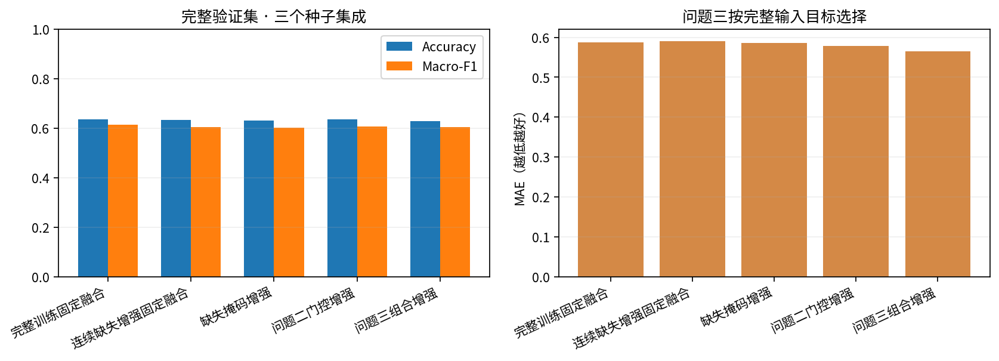
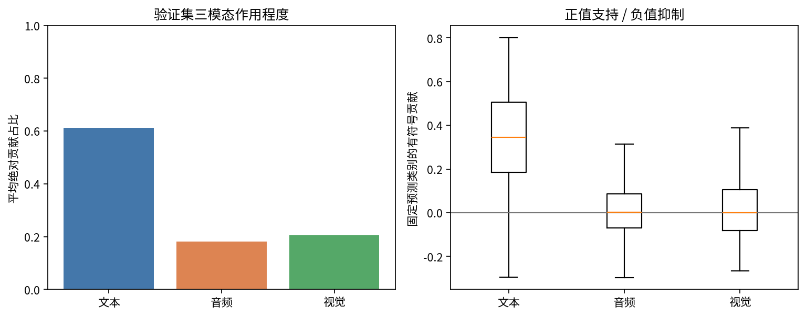
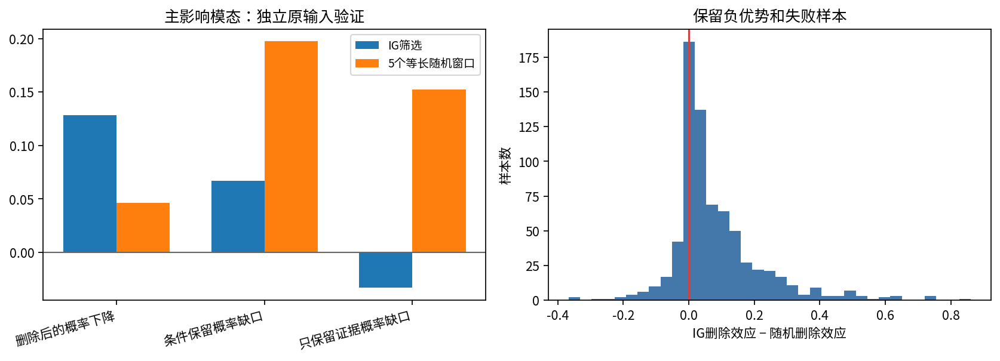
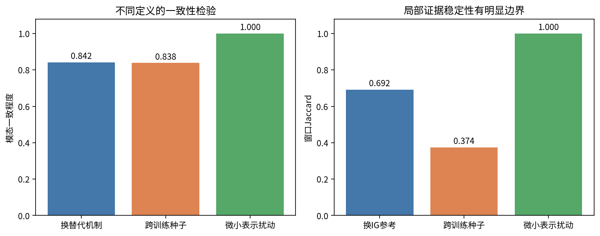
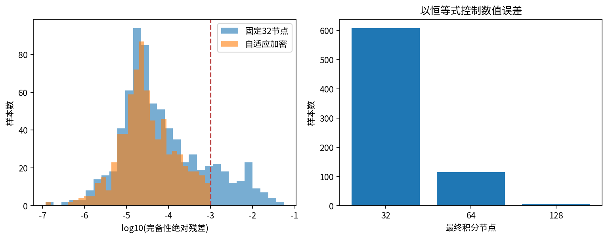
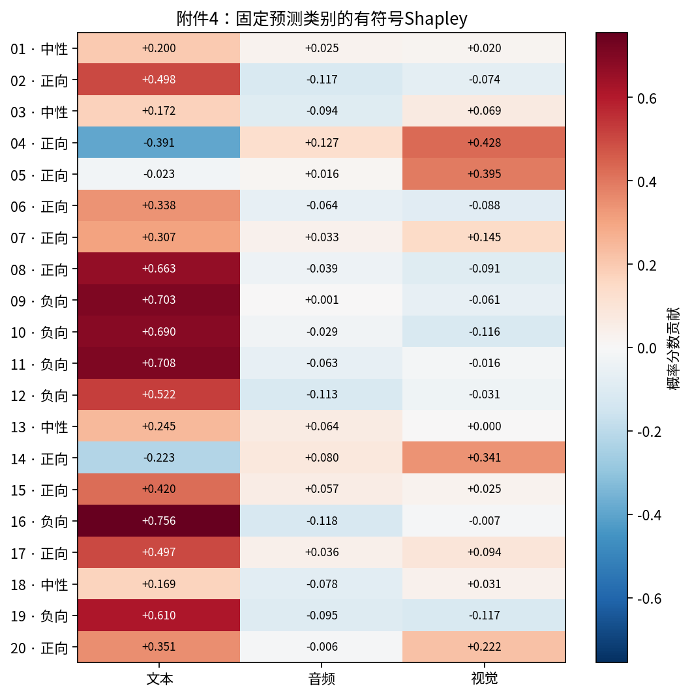
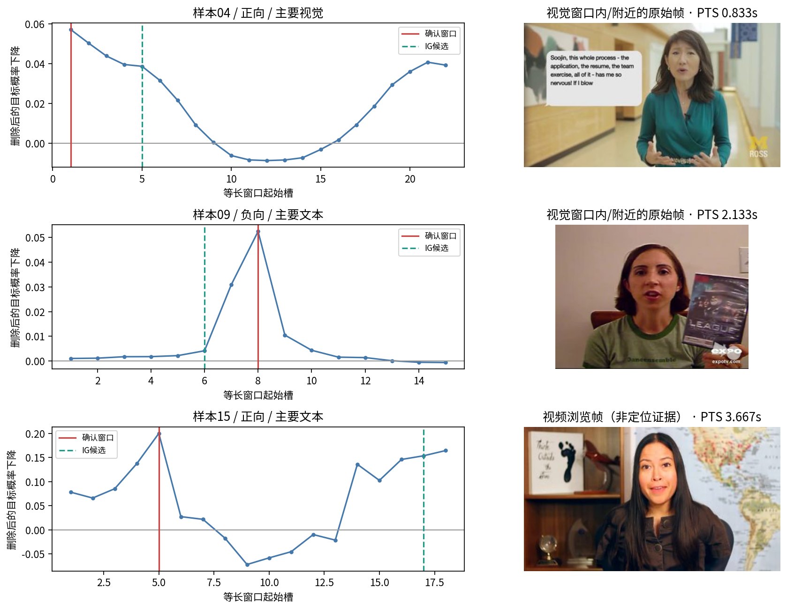
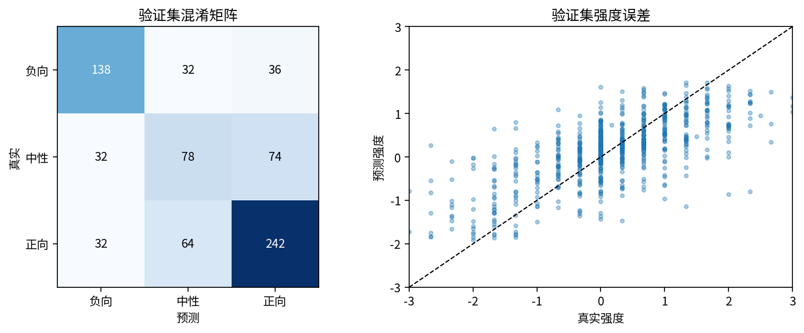

# 问题三实验报告

## 1. 完成结果与主要结论

完成可解释性预测模型、728条验证样本的解释检验、附件4全部20条预测与解释，以及20张可回看解释卡。最终采用 **问题三模态组合增强的三个种子集成**；按完整验证集选择，与问题二的缺失鲁棒性目标分开。

验证集Accuracy **0.6291**、Macro-F1 **0.6046**、MAE **0.5651**、Pearson **0.6904**。这些是参与模型选择的验证集成绩，不冒充新的独立盲测结果。

固定原预测类别后，IG筛选的主影响模态窗口被删除，目标概率平均下降 **12.84个百分点**；5个等长随机窗口平均下降 **4.64个百分点**。优势为 **8.20个百分点**，源视频聚类bootstrap 95%区间为 [7.15, 9.22] 个百分点。它是对模型解释忠实性的证据，不是情感预测准确率的提升。

局部解释并非普遍稳定：跨训练种子的窗口平均Jaccard仅 **0.374**。因此交付同时保留贡献方向、替代基线、种子差异、反向影响和时间定位限制。

交付入口：[解释审阅页](results/explanation_review.html)、[全量预测与解释CSV](results/附件4_问题三预测与解释.csv)、[数学模型定义](模型定义.md)、[代码说明](代码说明.md)。

## 2. 数据与预测模型

使用附件2对齐版训练3395、验证728；三分类编码0/1/2为负向/中性/正向，真实中性强度严格为0。参数、标准化和解释参考统计只由训练集学习。沿用统一冻结文本编码器及64维时序门控网络，损失为类别加权交叉熵加SmoothL1。

从问题二三个训练种子的权重出发，以80%完整输入和20%随机真子模态组合继续训练。初始化本身作为epoch0候选保留，三个种子的最佳轮次为 `{'17': 1, '29': 2, '43': 0}`。本次43号种子保留初始参数，不能写成所有组件都选用了组合增强之后的权重。

微调学习率0.0003，最多20轮，batch64，weight decay0.001，dropout0.2，早停耐心5。完整验证目标 `MAE+1−MacroF1` 最低的候选获选；配置、权重及哈希见 `protocol.json` 与 `selection_lock.json`。

| model | accuracy | macro_f1 | mae | pearson | neutral_recall |
| --- | --- | --- | --- | --- | --- |
| 完整训练固定融合 | 0.6346 | 0.6139 | 0.5880 | 0.6637 | 0.4728 |
| 连续缺失增强固定融合 | 0.6332 | 0.6050 | 0.5911 | 0.6573 | 0.3967 |
| 缺失掩码增强 | 0.6305 | 0.6021 | 0.5852 | 0.6531 | 0.4022 |
| 问题二门控增强 | 0.6346 | 0.6055 | 0.5784 | 0.6827 | 0.4076 |
| 问题三组合增强 | 0.6291 | 0.6046 | 0.5651 | 0.6904 | 0.4239 |

相对问题二门控集成，MAE由 0.5784 变为 0.5651；分类指标没有全面提高。不能把综合选择目标获胜表述为所有指标最优。附件2测试集已在问题二使用，本问没有将它重新宣称为未见盲测集；附件4无标签，不能计算专项准确率。

## 3. 解释的数学含义

分类解释目标固定为完整输入原预测类别的平均概率 `F_c(X')=mean(p_original_class(X'))`，遮挡后不改变类别目标；强度另解释平均回归输出。三模态8个组合精确枚举，按Shapley公式分配 `F(full)−F(empty)`。逐样本检查贡献总和；同时保存有符号贡献和绝对贡献占比，不把门控权重直接当解释。

主基线是模态不可用：特征为零、观测掩码为False、可用性统计重算。敏感性基线用训练集逐维特征中位数替换表示并保留原掩码，它是另一种干预机制。主导模态由最大绝对贡献确定；贡献极弱或分散时允许weak/mixed，不强行制造可信主导模态。

局部层先在连续表示上用IG排序，再对20%有效槽长度的连续窗口做原输入验证。文本必须先删除token和attention再重新编码；音视频删除的是题目提供的特征行，不等价于重新剪辑物理音视频并重新提取全部特征。积分路径的文本位置只用于候选排序，不将上下文向量直接称为原词贡献。

专项解释另外穷举同长度窗口并给出最大支持或强反向影响位置。该穷举结果用于定位与复算，不能用其按定义取得的最大删除分数循环证明忠实性；独立证据来自验证集预先IG排序后的随机对照。

详细公式、目标函数、替代规则、阈值和理论边界见 [模型定义.md](模型定义.md)。

## 4. 忠实性、充分性与反例

主影响模态上的结果如下。删除效应越大表示移除该片段越削弱原目标；保留缺口越小表示该片段在指定上下文中越能维持原目标。

| 指标 | IG | 随机 |
| --- | --- | --- |
| 删除后的概率下降 | 0.1284 | 0.0464 |
| 条件保留概率缺口 | 0.0669 | 0.1973 |
| 只保留证据概率缺口 | -0.0332 | 0.1523 |

条件保留（其他模态完整）的原类别保持率：IG **84.89%**、随机 **63.76%**。只保留一个模态的证据窗口、其他模态均移除时：IG **85.16%**、随机 **61.84%**。两种条件分开报告，不能把保留其他完整模态的试验称为“只靠该证据”。

无条件保留的平均概率缺口为负，说明在本模型与替代规则下，移除其他信息有时提高原类别概率。它可能反映模态冲突、输出先验或反事实分布变化；单凭负缺口不能证明该片段更真实或原样本多余。

主影响窗口的正删除效应比例为 **92.86%**，其余样本保留为失败/反向影响，不删去。预测正确与错误样本分别统计：

| 预测正确 | 样本数 | 删除优势 | 正删除效应比例 |
| --- | --- | --- | --- |
| False | 270 | 0.0689 | 0.9037 |
| True | 458 | 0.0897 | 0.9432 |

三模态分别的结果见 [fidelity_by_modality.csv](results/fidelity_by_modality.csv)，2184条逐样本逐模态记录见 [validation_fidelity_comparison.csv](results/validation_fidelity_comparison.csv)，全部39312个探测结果保存在 `validation_probe_outputs.npz`。主影响模态汇总使用绝对贡献最大的索引作受控对比；弱/混合样本的正式输出状态仍保留。

## 5. 稳定性、基线与数值精度

更换模态替代机制后，主要影响模态一致率 **84.20%**；跨种子平均主影响模态一致程度 **83.84%**。局部窗口对不同训练种子的敏感性明显，平均Jaccard **0.374**；更换IG参考表示时为 **0.692**。

在96条按真实三类各取32条的验证样本上，0.02标准差的微小表示扰动下，主模态一致率和窗口Jaccard均为 1.000。这只描述该小扰动，不能覆盖真实遮挡、说话人变化或任意噪声。不同指标定义也不同，不把它们混成统一“解释准确率”。

初始32节点IG最大完备性残差为 0.05773。按恒等式自适应加密后，节点数使用分布为 `{'32': 608, '64': 114, '128': 6}`，残差95%分位为 0.000467，最大值为 0.000994，超过0.001容差的样本数为 0。这是积分数值检查，不是预测精度评价。

## 6. 附件4全量预测与解释

20条预测分布为 `{'positive': 10, 'negative': 6, 'neutral': 4}`；主要参考模态为 `{'text': 17, 'vision': 3}`。作用程度是本模型对固定预测目标的贡献，不是人的真实情绪成因。音频没有成为这20条中最大的绝对贡献模态，不能因此删去音频结果或声称它没有作用。

| 样本 | 极性 | 强度 | 主要模态 | 文本贡献 | 音频贡献 | 视觉贡献 | 关键位置 |
| --- | --- | --- | --- | --- | --- | --- | --- |
| 01 | 中性 | 0.3991 | 文本 | 0.1998 | 0.0249 | 0.0202 | 槽[4,8)；估计1.48–2.68秒 |
| 02 | 正向 | 0.3385 | 文本 | 0.4979 | -0.1174 | -0.0739 | 槽[10,14)；估计1.44–2.04秒 |
| 03 | 中性 | -0.0117 | 文本 | 0.1724 | -0.0940 | 0.0687 | 槽[1,8)；估计0.50–1.60秒 |
| 04 | 正向 | 0.3809 | 视觉 | -0.3914 | 0.1271 | 0.4277 | 槽[1,6)；估计0.50–1.14秒 |
| 05 | 正向 | 0.7098 | 视觉 | -0.0227 | 0.0164 | 0.3952 | 槽[1,4)；估计1.26–2.06秒 |
| 06 | 正向 | 0.1969 | 文本 | 0.3383 | -0.0640 | -0.0876 | 槽[18,25)；估计3.22–5.68秒 |
| 07 | 正向 | 0.8406 | 文本 | 0.3067 | 0.0334 | 0.1453 | 槽[14,24)；估计3.00–7.66秒 |
| 08 | 正向 | 0.8637 | 文本 | 0.6628 | -0.0390 | -0.0913 | 槽[2,4)；估计0.86–1.20秒 |
| 09 | 负向 | -1.9973 | 文本 | 0.7031 | 0.0010 | -0.0613 | 槽[8,12)；估计1.48–2.32秒 |
| 10 | 负向 | -0.8015 | 文本 | 0.6896 | -0.0286 | -0.1158 | 槽[25,31)；时间待复核 |
| 11 | 负向 | -1.5917 | 文本 | 0.7075 | -0.0630 | -0.0164 | 槽[4,7)；估计0.92–3.46秒 |
| 12 | 负向 | -0.6376 | 文本 | 0.5218 | -0.1132 | -0.0305 | 槽[34,42)；估计9.94–12.26秒 |
| 13 | 中性 | 0.1479 | 文本 | 0.2449 | 0.0645 | 0.0000 | 槽[9,15)；估计1.62–4.36秒 |
| 14 | 正向 | 0.5526 | 视觉 | -0.2226 | 0.0803 | 0.3405 | 槽[1,8)；估计0.50–1.44秒 |
| 15 | 正向 | 0.7544 | 文本 | 0.4197 | 0.0566 | 0.0249 | 槽[5,9)；时间待复核 |
| 16 | 负向 | -1.8128 | 文本 | 0.7558 | -0.1184 | -0.0074 | 槽[10,12)；时间待复核 |
| 17 | 正向 | 1.2345 | 文本 | 0.4971 | 0.0361 | 0.0941 | 槽[19,24)；估计7.84–9.02秒 |
| 18 | 中性 | -0.3897 | 文本 | 0.1685 | -0.0781 | 0.0307 | 槽[7,17)；估计1.72–5.08秒 |
| 19 | 负向 | -0.4397 | 文本 | 0.6096 | -0.0950 | -0.1175 | 槽[12,20)；估计3.90–6.92秒 |
| 20 | 正向 | 0.8572 | 文本 | 0.3509 | -0.0064 | 0.2221 | 槽[18,27)；估计4.56–6.78秒 |

20条CSV每行都包含三模态贡献及三个关键证据记录；`evidence` 为规范JSON，保存原文字符、特征槽、贡献方向、IG候选、确认删除效应、时间状态和关键帧。详细解释卡数据见 [special_explanations.json](results/special_explanations.json)。

## 7. 典型解释卡与时间映射

选取04号展示视觉为主且模态方向相反的情况，09号展示负向文本证据，15号展示时间映射风险。三者均无专项标签，因此只能讨论模型的预测依据，不能断言预测正确。

对20个视频均按实际PTS解码；原文不被诊断ASR替换，分词ID与所用词表全量一致。原题给出对齐槽对应关系，另对同词多子词的音视频特征重复进行了核查：共 29 组，音频一致 29 组、视觉一致 29 组。这支持组织规则解释，但不能独立证明官方特征的物理提取时间。

CTC与原文offset用于估计时间，没有用位置比例乘视频时长。通过片段级保守质控的样本有 18 条；最终选中证据可提供保守估计时间的数量分别为文本 17、音频 15、视觉 16。其他局部窗口含低置信词或整体匹配风险，只保留候选时间、原文和槽位；不能把它们写成可靠定位。

需重点复核的原文件：

- **对齐版本/15.pkl 与 videos/15.mp4**：提供转写从“However, despite their poverty...”开始，但诊断识别的大部分内容是此前父亲去世及家庭经济困境，末尾只到“however despite their pover...”。CTC平均分数约0.006，不能将整段提供文本强制分配到这段视频上。保留文本/特征证据，不补造时间。
- **对齐版本/16.pkl 与 videos/16.mp4**：诊断识别与给定句子有相近内容，但整句WER为0.875并带有额外尾部，触发既定复核规则。没有因看起来相似而事后放宽阈值，也不宣称视频一定配错。

7号和18号原文超过模型50槽上限，截断之外的文本不参与预测。句子完整CTC对齐保留，但不能将模型未读到的尾部作为其证据。

全部20条都有精确的提供原文字符与特征槽对应记录。当前 4 张视觉图片由于选定区间不能可靠定位，只是**全片浏览帧，非已定位证据**。其他帧仍是依据估计词时间选取的原始帧，记录真实PTS而非生成画面。音视频时间映射方法、置信度和局部限制见 [time_mapping_audit.csv](results/time_mapping_audit.csv) 与 [token_time_mapping.csv](results/token_time_mapping.csv)。

## 8. 验证集错误诊断与交付

| 分组 | 样本数 | Accuracy | MAE | 偏差 |
| --- | --- | --- | --- | --- |
| 强负向 | 58 | 0.9310 | 0.9882 | 0.9733 |
| 弱负向 | 148 | 0.5676 | 0.6085 | 0.4569 |
| 中性 | 184 | 0.4239 | 0.3591 | 0.1481 |
| 弱正向 | 266 | 0.6579 | 0.4563 | -0.2789 |
| 强正向 | 72 | 0.9306 | 1.0631 | -1.0618 |

中性召回为 0.4239，弱情感和中性边界仍容易混淆；强情感幅度存在向中间收缩的偏差。最差8条及逐样本真值、预测见 [representative_errors.csv](results/representative_errors.csv)。对错误预测作出忠实解释，并不使预测变正确；解释检验和预测评价必须分别保留。

CSV、数学定义、模型权重、训练日志、环境、基线比较、全量探测记录和解释卡全部提供。脚本执行与恢复方式见 [代码说明.md](代码说明.md)。根环境未被修改；提交包排除原始视频、冻结通用大模型和可重建缓存，保留精确版本及哈希。三问累计附件大小由最终打包程序核验。
